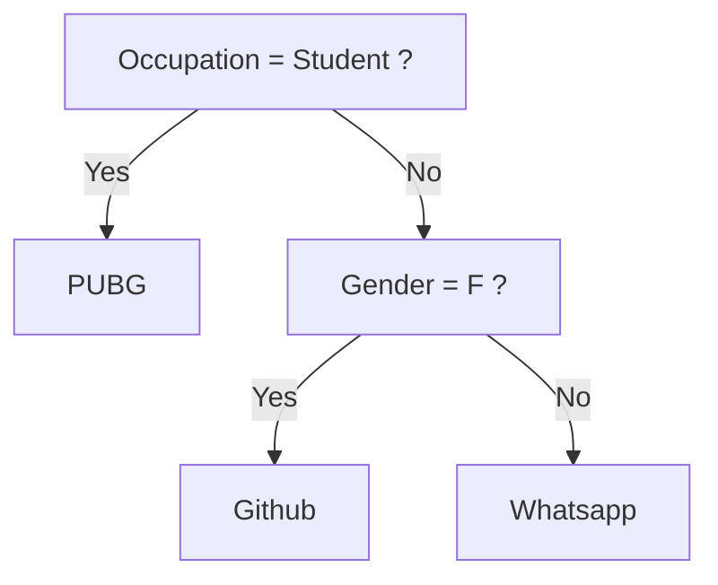
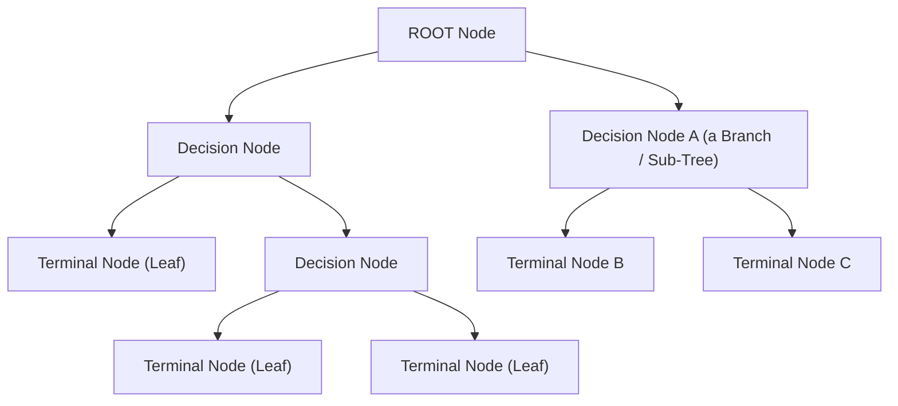
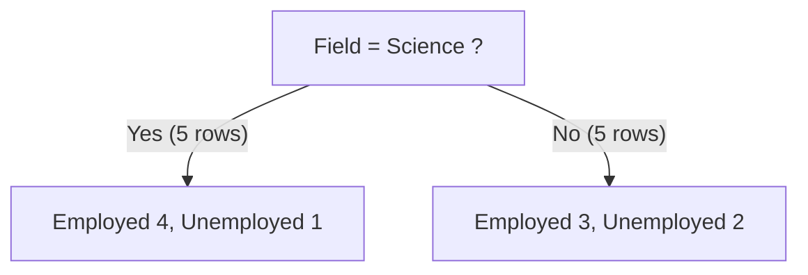
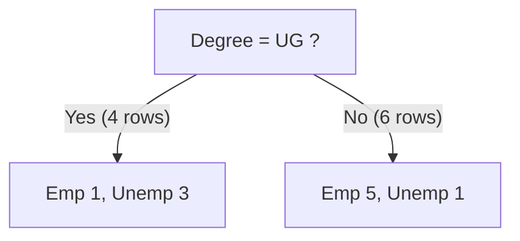
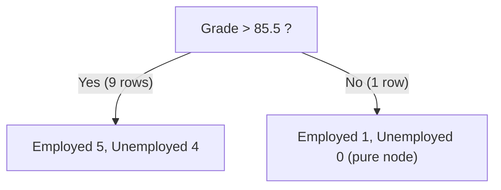
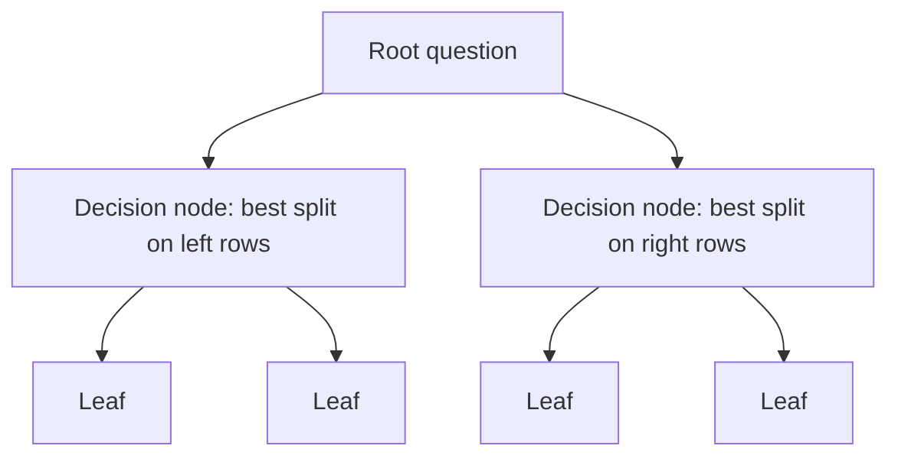

# Decision Trees, Part 1: Foundations & the CART Algorithm

> **Series:** **Part 1: Foundations & CART** (this file) · [Part 2: Regression, Prediction & Feature Importance](../02-regression-prediction-and-feature-importance/README.md) · [Part 3: Overfitting & Pruning](../03-overfitting-and-pruning/README.md)

This part builds the whole idea from scratch: what a decision tree is, how the CART algorithm chooses questions, how Gini impurity is computed by hand, how categorical and numerical features are split, what a tree looks like geometrically, and where trees shine or fail.

**Prerequisites:** basic Python, the idea of a classification dataset (features `X`, label `y`). No prior tree knowledge needed.

**After this part you will be able to:**
- explain a decision tree in one minute to a non-technical person,
- compute Gini impurity and the weighted split score by hand,
- explain how a tree picks its root question,
- train and visualize a tree with scikit-learn.

---

## Table of Contents

1. [Introduction](#1-introduction)
2. [Intuition behind DT](#2-intuition-behind-dt)
3. [Vocab](#3-vocab)
4. [Example 2](#4-example-2)
5. [The CART Algorithm: Classification](#5-the-cart-algorithm-classification)
6. [Splitting Categorical Features](#6-splitting-categorical-features)
7. [Splitting Numerical Features](#7-splitting-numerical-features)
8. [Understanding Gini Impurity](#8-understanding-gini-impurity)
9. [Geometric Intuition of DT](#9-geometric-intuition-of-dt)
10. [Code](#10-code)
11. [The CART Algorithm: Regression (preview)](#11-the-cart-algorithm-regression-preview)
12. [Code (Regression)](#12-code-regression)
13. [Advantages and Disadvantages](#13-advantages-and-disadvantages)
14. [Summary & Practice Questions](#14-summary--practice-questions)

---

## 1. Introduction

A **Decision Tree (DT)** predicts by asking a sequence of simple questions about the input features, like a flowchart, until it reaches an answer.

### The four headline facts

| Fact | What it means |
|---|---|
| **Non-parametric** | The model does not assume a fixed formula such as $y = w_1x_1 + w_2x_2 + b$. The structure of the tree (how many questions, which features) is decided by the data. This is why trees can capture **non-linear** relationships. |
| **White-box model** | Every prediction can be traced as a list of human-readable rules (`if grade > 89.5 and degree == UG ...`). Compare with a neural network, where the "reason" is buried in millions of weights. |
| **Mother of all tree-based algorithms** | **Random Forest**, **Gradient Boosting**, **XGBoost**, **LightGBM**, **CatBoost**, **AdaBoost** all use decision trees as their building block. Understanding one tree deeply makes all of them easy. |
| **Works for both tasks** | **Classification** (predict a category, e.g. Employed / Unemployed) and **Regression** (predict a number, e.g. a test score). |

### Parametric vs non-parametric (why it matters)

| | Parametric (e.g. linear regression) | Non-parametric (decision tree) |
|---|---|---|
| Shape of the model | Fixed in advance (a line / plane) | Grows with the data |
| Number of learned values | Fixed (the weights) | Varies (number of nodes) |
| Handles non-linear data | Only with feature engineering | Naturally |
| Risk | Underfit if the shape is wrong | **Overfit** if allowed to grow freely (see Part 3) |

---

## 2. Intuition behind DT

Suppose an app wants to suggest something to users based on **Gender** and **Occupation**:

| Gender | Occupation | Suggestion |
|--------|------------|------------|
| F | Student | PUBG |
| F | Programmer | Github |
| M | Programmer | Whatsapp |
| F | Programmer | Github |
| M | Student | PUBG |
| M | Student | PUBG |

Look at the data like a human would:

- Every **student** (F or M) got **PUBG**. So Occupation = Student alone is enough to decide those rows.
- Among **programmers**, gender matters: **F → Github**, **M → Whatsapp**.

Writing that as code gives a **giant nested if-else structure**:

```python
if occupation == "Student":
    print("PUBG")
else:
    if gender == "F":
        print("Github")
    else:
        print("Whatsapp")
```

And the same logic as a tree:



### The key idea

> A decision tree is a **nested if-else structure that is learned automatically from data**, instead of being written by a human.

To learn it, the algorithm must answer three questions:

1. **Which question should be the first one (the root)?** Here: `Occupation = Student`.
2. **Which question should come next, on each branch?** Here: `Gender = F` on the "No" branch only.
3. **When should it stop asking and answer?** When a branch is pure (all rows agree), the leaf gives the answer.

The act of choosing a question (a feature plus a value, such as `Occupation = Student`) to divide the data into two groups is called **splitting**.

### Why was `Occupation` the root and not `Gender`?

Try both:

- Splitting on **Occupation = Student**: the Yes-group (3 students) is **all PUBG**, perfectly pure. The No-group (3 programmers) still needs one more question.
- Splitting on **Gender = F**: the Yes-group (F: PUBG, Github, Github) is mixed, and the No-group (M: Whatsapp, PUBG, PUBG) is mixed. Neither group is clean.

Occupation produces cleaner groups, so it is the better first question. The rest of this part makes "cleaner" precise with a number called **impurity**.

### Tree analogy

```
        root          <- first question (top of the tree)
       /    \
   branch   branch    <- more questions
   /  \      /  \
 leaf leaf leaf leaf  <- final answers
```

It is a real tree turned upside-down: the **root** is at the top, and the **leaves** (final answers) are at the bottom.

---

## 3. Vocab



| Term | Meaning |
|------|---------|
| **Root Node** | The topmost node. It holds the **entire training dataset** and asks the first question. |
| **Splitting** | The process of dividing a node into sub-nodes using a (feature, value) question. |
| **Decision Node** (internal node) | A node that asks a question and splits further. |
| **Terminal Node / Leaf Node** | A node that does **not** split any more. It stores the final prediction. |
| **Branch / Sub-Tree** | A decision node together with everything below it. In the figure, A with B and C is a sub-tree. |
| **Parent / Child Node** | A node that splits is the **parent** of the nodes it creates (the **children**). In the figure, **A is the parent node of B and C.** |
| **Sibling nodes** | Two children of the same parent (B and C). |
| **Depth of a node** | Number of edges from the root to that node. Root has depth 0. |
| **Depth of the tree** | The depth of the deepest leaf. A tree with only a root has depth 0. |
| **Pruning** | Removing sub-trees to make the tree smaller (covered in Part 3). |

**Binary tree:** CART always splits a node into exactly **two** children (Yes / No), so the trees are binary.

---

## 4. Example 2

Here is a more realistic dataset: predict whether a graduate is employed.

| | Degree_Type | Field | Average_Grade | Job_Outcome |
|--|-------------|-------|---------------|-------------|
| 0 | Undergraduate | Science | 89 | Employed |
| 1 | Undergraduate | Arts | 92 | Unemployed |
| 2 | Postgraduate | Science | 95 | Employed |
| 3 | PhD | Science | 85 | Employed |
| 4 | Postgraduate | Arts | 98 | Unemployed |
| 5 | PhD | Arts | 90 | Employed |
| 6 | Undergraduate | Science | 88 | Unemployed |
| 7 | Postgraduate | Arts | 93 | Employed |
| 8 | Undergraduate | Arts | 94 | Unemployed |
| 9 | PhD | Science | 86 | Employed |
| 10 | Undergraduate | Arts | 91 | Unemployed |
| 11 | Postgraduate | Arts | 96 | Employed |
| 12 | PhD | Science | 87 | Employed |
| 13 | Undergraduate | Science | 90 | Unemployed |
| 14 | Postgraduate | Science | 95 | Employed |

### Inputs and output

| Column | Role | Type |
|---|---|---|
| `Degree_Type` | **Input** feature | Categorical, **multi-class** (3 values) |
| `Field` | **Input** feature | Categorical, **binary** (2 values) |
| `Average_Grade` | **Input** feature | **Numerical** |
| `Job_Outcome` | **Output** (target) | Binary class |

One data point looks like `{UG, Science, 90}`, and we want to predict Employed / Unemployed.

### Scale

This toy table has **15 rows**, but real datasets can have lakhs of rows, so the algorithm that builds the tree must be **systematic and efficient**, not guesswork.

### Which algorithm builds the tree?

| Algorithm | Splits | Criterion | Features | Notes |
|---|---|---|---|---|
| **ID3** | Multi-way (one branch per category) | Information gain (entropy) | Categorical only | Oldest; no pruning; no numerical features |
| **C4.5** | Multi-way / binary | Gain ratio | Categorical + numerical | Improves ID3; handles missing values; has pruning |
| **CART** | **Binary** | Gini (classification), variance (regression) | Categorical + numerical | Handles regression too. **This is what scikit-learn implements.** |

> scikit-learn uses an optimized version of **CART**. When these notes say "decision tree" in code, they mean CART.

---

## 5. The CART Algorithm: Classification

**CART = Classification And Regression Trees.** It is the algorithm used to **grow** a decision tree. In scikit-learn it powers both `DecisionTreeClassifier` and `DecisionTreeRegressor`.

### 5.1 Formal description

Given training vectors $x_i \in \mathbb{R}^n$, $i = 1, \dots, l$, and a label vector $y \in \mathbb{R}^l$, a decision tree **recursively partitions the feature space** so that samples with the same labels (or similar target values) end up grouped together.

**Step 1: Candidate splits.**
Let the data at node $m$ be $Q_m$, containing $n_m$ samples. A **candidate split** is a pair

$$
\theta = (j, t_m)
$$

made of a **feature $j$** and a **threshold $t_m$**. It partitions the node's data into two subsets:

$$
Q_m^{left}(\theta) = \{(x, y) \mid x_j \le t_m\}
$$

$$
Q_m^{right}(\theta) = Q_m \setminus Q_m^{left}(\theta)
$$

**Step 2: Score each candidate.**
The quality of a candidate split is computed with an **impurity function** (or loss function) $H(\cdot)$. Which function is used depends on the task (classification or regression):

$$
G(Q_m, \theta) = \frac{n_m^{left}}{n_m}\, H\!\big(Q_m^{left}(\theta)\big) + \frac{n_m^{right}}{n_m}\, H\!\big(Q_m^{right}(\theta)\big)
$$

$G$ is the **weighted average impurity of the two children**. The weights are the fractions of rows that go left and right. Lower $G$ is better.

**Step 3: Choose the best split.**
Select the parameters that **minimize** the impurity:

$$
\theta^{*} = \underset{\theta}{\arg\min}\; G(Q_m, \theta)
$$

**Step 4: Recurse.**
Repeat Steps 1-3 on $Q_m^{left}(\theta^*)$ and $Q_m^{right}(\theta^*)$ until a **stopping condition** is met:

- the maximum allowable depth is reached, or
- $n_m < \min_{samples}$ (too few rows to split), or
- $n_m = 1$ (a single row), or
- the node is already pure.

### 5.2 The same thing in plain words

Take a dataset with $n$ rows and $m$ feature columns $f_1, f_2, \dots, f_m$, plus the target $y$.

```
 f1   f2   f3  ...  fm  |  y
 --   --   --       --  |  --
 .    .    .        .   |  Y
 .    .    .        .   |  N
 ...                    |  ...
        n rows
```

At the **root**, the model searches:

1. Take a feature $f_i$ and a value $v$. This pair is the **splitting criterion** $\theta$ ("is $f_i$ at (or below) $v$?").
2. The rows are divided into **$D_1$** (the "Yes" rows, $n_{left}$ of them) and **$D_2$** (the "No" rows, $n_{right}$ of them).
3. Compute the impurity $H()$ of $D_1$ and of $D_2$.
4. Combine them into the **overall impurity**:

$$
G = \frac{n_{left}}{n}\, H_{left} + \frac{n_{right}}{n}\, H_{right}
$$

5. Repeat for **every feature and every candidate value**.
6. Keep the pair with the **lowest** $G$. That becomes the root question.
7. Run the same procedure separately on $D_1$ and $D_2$, and so on, down the tree.

### 5.3 Pseudocode

```text
function BuildTree(data, depth):
    if stopping_condition(data, depth):          # pure / too small / max depth
        return Leaf(prediction = majority_class(data))

    best = None
    for each feature j:
        for each candidate threshold t of feature j:
            left, right = split(data, j, t)
            score = (|left|/|data|) * H(left) + (|right|/|data|) * H(right)
            if best is None or score < best.score:
                best = (j, t, score, left, right)

    node = DecisionNode(question = (best.j, best.t))
    node.left  = BuildTree(best.left,  depth + 1)
    node.right = BuildTree(best.right, depth + 1)
    return node
```

### 5.4 The impurity function $H()$

| Task | Impurity function $H()$ |
|------|-------------------------|
| **Classification** | **Gini impurity** (default in sklearn) or **Entropy** |
| **Regression** | **MSE / Variance** (or MAE). See Part 2. |

### 5.5 Important properties of CART

- **Greedy:** at each node it picks the *locally* best split, without looking ahead. Finding the globally optimal tree is computationally intractable (NP-complete), so greedy is the practical choice. Consequence: the final tree is good, not guaranteed best.
- **Recursive / top-down:** the same procedure is applied on every sub-dataset.
- **Binary:** every split has exactly two outcomes.
- **Exhaustive per node:** every feature and every candidate threshold is evaluated at every node.

---

## 6. Splitting Categorical Features

### 6.1 The scoring formula (Gini)

$$
\text{Gini} = 1 - \sum_{k=1}^{K} p_k^{2}
$$

where $p_k$ is the probability (fraction) of class $k$ in the node, and $K$ is the number of classes.

### 6.2 The data used in this walkthrough

The **first 10 rows** of Example 2:

| | Degree_Type | Field | Average_Grade | Job_Outcome |
|--|---|---|---|---|
| 0 | Undergraduate | Science | 89 | Employed |
| 1 | Undergraduate | Arts | 92 | Unemployed |
| 2 | Postgraduate | Science | 95 | Employed |
| 3 | PhD | Science | 85 | Employed |
| 4 | Postgraduate | Arts | 98 | Unemployed |
| 5 | PhD | Arts | 90 | Employed |
| 6 | Undergraduate | Science | 88 | Unemployed |
| 7 | Postgraduate | Arts | 93 | Employed |
| 8 | Undergraduate | Arts | 94 | Unemployed |
| 9 | PhD | Science | 86 | Employed |

Overall counts: **6 Employed, 4 Unemployed**. Parent Gini $= 1 - 0.6^2 - 0.4^2 = \mathbf{0.48}$. (This is the impurity *before* any split, so a split is useful only if it brings $G$ below 0.48.)

There are three kinds of features: **binary**, **multi-class**, and **numerical**. Each is split a little differently.

### 6.3 Binary categorical feature: `Field`

There are only two values (Science, Arts), so there is **one** candidate question: **"Is `Field = Science`?"**



**Yes-branch** (4 Employed, 1 Unemployed): $p_{emp} = \tfrac{4}{5},\; p_{unemp} = \tfrac{1}{5}$

$$
\text{Gini}_{yes} = 1 - \left(\tfrac45\right)^2 - \left(\tfrac15\right)^2 = 1 - \tfrac{16}{25} - \tfrac{1}{25} = \tfrac{8}{25} = 0.32
$$

**No-branch** (3 Employed, 2 Unemployed): $p_{emp} = \tfrac{3}{5},\; p_{unemp} = \tfrac{2}{5}$

$$
\text{Gini}_{no} = 1 - \left(\tfrac35\right)^2 - \left(\tfrac25\right)^2 = 1 - \tfrac{9}{25} - \tfrac{4}{25} = \tfrac{12}{25} = 0.48
$$

**Weighted impurity** (each side has 5 of 10 rows):

$$
G(\text{Field},\,\text{Science}) = \tfrac{5}{10}\times\tfrac{8}{25} + \tfrac{5}{10}\times\tfrac{12}{25} = 0.16 + 0.24 = \mathbf{0.40}
$$

**Impurity decrease** (how much this split helped): $0.48 - 0.40 = 0.08$.

### 6.4 Multi-class categorical feature: `Degree_Type`

`Degree_Type` has three values: **UG, PG, PhD**. A single yes/no question can only isolate **one** group, so CART tries one-vs-rest questions:

- `Degree = UG` ? &nbsp; (UG vs {PG, PhD})
- `Degree = PG` ? &nbsp; (PG vs {UG, PhD})
- `Degree = PhD` ? (PhD vs {UG, PG})

For each candidate, count Employed/Unemployed on both sides, compute Gini of both sides, then the weighted $G$:

| Candidate split | Yes: Emp / Unemp | No: Emp / Unemp | Gini (yes) | Gini (no) | Weighted $G$ |
|---|---|---|---|---|---|
| `Degree = UG` | 1 / 3 | 5 / 1 | 0.375 | 0.278 | **0.317** |
| `Degree = PG` | 2 / 1 | 4 / 3 | 0.444 | 0.490 | 0.476 |
| `Degree = PhD` | 3 / 0 | 3 / 4 | 0.000 | 0.490 | 0.343 |

**Worked arithmetic for `Degree = UG`:**

- Yes (rows 0, 1, 6, 8): 1 Emp, 3 Unemp → $1 - (\tfrac14)^2 - (\tfrac34)^2 = 1 - \tfrac{1}{16} - \tfrac{9}{16} = \tfrac{6}{16} = 0.375$
- No (the other 6 rows): 5 Emp, 1 Unemp → $1 - (\tfrac56)^2 - (\tfrac16)^2 = \tfrac{10}{36} \approx 0.278$
- $G = \tfrac{4}{10}(0.375) + \tfrac{6}{10}(0.278) = 0.150 + 0.167 = \mathbf{0.317}$

**Worked arithmetic for `Degree = PhD`:** the Yes group (rows 3, 5, 9) is **all Employed**, a pure node with Gini 0. The No group has 3 Emp / 4 Unemp → $1 - \tfrac{9}{49} - \tfrac{16}{49} = \tfrac{24}{49} \approx 0.490$. So $G = \tfrac{3}{10}(0) + \tfrac{7}{10}(0.490) = 0.343$.

> **How many ways to split a multi-class feature?** For a feature with $k$ categories, grouping the categories into two non-empty sets gives $2^{k-1} - 1$ possible binary splits. For $k = 3$ that is $3$, which is exactly the three one-vs-rest splits above. For $k = 4$ there are 7 exhaustive splits versus 4 one-vs-rest. Using one-vs-rest keeps the search cheap and is the version followed in these notes.

### 6.5 Picking the winner across all categorical candidates

Every (feature, value) pair gets a $G$ score. The pair with the **minimum $G$** wins:

| Candidate $\theta$ | $G$ |
|---|---|
| (Field, Science) | 0.400 |
| **(Degree, UG)** | **0.317** ← minimum |
| (Degree, PG) | 0.476 |
| (Degree, PhD) | 0.343 |

So among categorical questions, **"Is `degree = UG`?"** is the best. Numerical thresholds from `Average_Grade` also compete (next section), and the single best of *all* candidates becomes the split.



Then the algorithm recurses on both children.

### 6.6 Practical note: categorical features in scikit-learn

scikit-learn's trees expect **numeric** arrays. Convert categoricals first:

- **One-hot encoding:** `Degree_Type` becomes three 0/1 columns (`Degree_Type_UG`, ...). A threshold split `Degree_Type_UG <= 0.5` is exactly the question "is degree = UG?".
- **Ordinal encoding:** fine when the categories truly have an order (e.g. Freshman < Sophomore < Junior < Senior). For unordered categories it can invent a false order.

---

## 7. Splitting Numerical Features

A numerical feature such as `Average_Grade` could be split at infinitely many thresholds, but only a small number of thresholds actually change which rows go left or right.

### 7.1 The procedure

1. **Sort** the rows by the feature value.
2. Take the **midpoint** between every pair of consecutive *distinct* values as a candidate threshold.
3. For each threshold: split into `feature ≤ t` (left) and `feature > t` (right), compute $G$.
4. Keep the threshold with the minimum $G$.

For $n$ distinct values there are at most $n - 1$ candidate thresholds.

### 7.2 Worked example (first 10 rows)

Sorted by `Average_Grade`:

| Grade | 85 | 86 | 88 | 89 | 90 | 92 | 93 | 94 | 95 | 98 |
|---|---|---|---|---|---|---|---|---|---|---|
| Outcome | Emp | Emp | Unemp | Emp | Emp | Unemp | Emp | Unemp | Emp | Unemp |

Candidate thresholds (midpoints):

`85.5, 87, 88.5, 89.5, 91, 92.5, 93.5, 94.5, 96.5`

**Detailed example: threshold `Grade > 85.5`**



- Yes-branch: $1 - \left(\tfrac59\right)^2 - \left(\tfrac49\right)^2 = 1 - \tfrac{25}{81} - \tfrac{16}{81} = \tfrac{40}{81} \approx 0.494$
- No-branch: $1 - 1^2 - 0^2 = 0$. A **pure node** (Gini = 0)
- Weighted: $G = \tfrac{9}{10}\times\tfrac{40}{81} + \tfrac{1}{10}\times 0 \approx \mathbf{0.444}$

**The same calculation for every threshold:**

| Threshold | Left (≤): Emp / Unemp | Right (>): Emp / Unemp | Weighted $G$ |
|---|---|---|---|
| 85.5 | 1 / 0 | 5 / 4 | 0.444 |
| 87 | 2 / 0 | 4 / 4 | 0.400 |
| 88.5 | 2 / 1 | 4 / 3 | 0.476 |
| 89.5 | 3 / 1 | 3 / 3 | 0.450 |
| 91 | 4 / 1 | 2 / 3 | 0.400 |
| 92.5 | 4 / 2 | 2 / 2 | 0.467 |
| 93.5 | 5 / 2 | 1 / 2 | 0.419 |
| 94.5 | 5 / 3 | 1 / 1 | 0.475 |
| 96.5 | 6 / 3 | 0 / 1 | 0.400 |

The best grade threshold achieves $G = 0.40$ (a three-way tie at 87, 91, and 96.5; scikit-learn keeps the first one it finds). Compared with the categorical candidates (best: 0.317), the categorical split `Degree = UG` is better, so it wins the root.

### 7.3 Growing the rest of the tree

After the root, each child is a smaller dataset, and the *entire search* (all features, all thresholds) runs again on it:



A feature can be reused at several depths (e.g. `Average_Grade` with different thresholds on different branches).

### 7.4 Why midpoints and not the values themselves?

Splitting at the midpoint between 85 and 86 (i.e. 85.5) places the boundary in the **gap** between two training points, which is the most natural choice and handles a new value like 85.7 sensibly. The *outcome* (which rows go left/right) is the same for any threshold inside the gap.

### 7.5 Efficiency tip

You don't need to recompute from scratch for each threshold. After sorting once, you slide a pointer along the sorted column and **update the class counts** incrementally. This is why training is roughly $O(n \log n)$ per feature per node (dominated by sorting).

---

## 8. Understanding Gini Impurity

> **Gini impurity** is a measure of how often a randomly chosen element from the set would be **incorrectly labelled** if it were randomly labelled according to the distribution of labels in the subset.

### 8.1 Why the formula looks like that

Pick one element at random from a node. Its true class is $k$ with probability $p_k$. Now label it randomly using the same distribution: you guess class $k$ with probability $p_k$. The chance of being **right** is $\sum_k p_k^2$, so the chance of being **wrong** is:

$$
\text{Gini} = 1 - \sum_{k} p_k^2 = \sum_{k} p_k (1 - p_k)
$$

### 8.2 Reading the number

| Gini | Meaning |
|---|---|
| **0** | **Pure node.** Every element has the same class. Nothing left to learn here: it becomes a leaf. |
| **Increasing** | More mixed classes. |
| **0.5** | Maximum for **two** classes (a perfect 50/50 mix). |
| $1 - \tfrac{1}{K}$ | Maximum for $K$ classes (0.667 for 3 classes, 0.75 for 4). |

### 8.3 Examples (two classes)

| Node content | Calculation | Gini |
|---|---|---|
| 10 Emp, 0 Unemp | $1 - 1 - 0$ | **0** (pure) |
| 9 Emp, 1 Unemp | $1 - 0.81 - 0.01$ | 0.18 |
| 8 Emp, 2 Unemp | $1 - 0.64 - 0.04$ | 0.32 |
| 7 Emp, 3 Unemp | $1 - 0.49 - 0.09$ | 0.42 |
| 5 Emp, 5 Unemp | $1 - 0.25 - 0.25$ | **0.50** (worst) |

### 8.4 Gini versus Entropy

Both measure "mixedness". Entropy is the other common choice:

$$
\text{Entropy} = -\sum_{k} p_k \log_2 p_k
$$

| | Gini | Entropy |
|---|---|---|
| Range (2 classes) | 0 to 0.5 | 0 to 1 |
| Speed | Faster (no logarithm) | Slightly slower |
| Behaviour | Similar splits in most datasets | Similar splits in most datasets |
| sklearn | `criterion="gini"` (default) | `criterion="entropy"` |

**Information gain** is the entropy-based counterpart of "impurity decrease":

$$
IG = H(\text{parent}) - \sum_{c \in \{L, R\}} \frac{n_c}{n}\, H(c)
$$

**Example: the `Field = Science` split** (parent: 6 Emp / 4 Unemp)

- $H(\text{parent}) = -0.6\log_2 0.6 - 0.4\log_2 0.4 \approx 0.971$
- $H(\text{yes: }4/1) \approx 0.722$, $H(\text{no: }3/2) \approx 0.971$
- Weighted children $= 0.5(0.722) + 0.5(0.971) \approx 0.846$
- $IG \approx 0.971 - 0.846 = \mathbf{0.125}$

(The same split gives a Gini decrease of $0.48 - 0.40 = 0.08$. Different scale, same story: a mild improvement.)

### 8.5 What "good split" means, in one sentence

> A good split produces children that are **purer** than the parent, and the weighting by child size makes sure a tiny pure child cannot fool the algorithm into picking a useless split.

---

## 9. Geometric Intuition of DT

### 9.1 Splits are axis-parallel lines

Each split uses **one feature and one threshold**:

- Splitting on $x_1 \le 5$ draws a **vertical** line at $x_1 = 5$.
- Splitting on $x_2 \le 3$ draws a **horizontal** line at $x_2 = 3$.

Every new question cuts one existing rectangle into two.

```
   x2
    |            |
  6 |   A  A     |   B  B
    |            |
  3 |------------+-----------   <- split 2: x2 <= 3 (right region)
    |   A  A     |   A  A
    |            |
    +------------+------------ x1
                 5               <- split 1: x1 <= 5
```

The **leaves of the tree correspond one-to-one with rectangles** (regions) of the feature space, and each region is assigned one class.

### 9.2 Consequences

| Observation | Why |
|---|---|
| Boundaries are **horizontal/vertical staircases** | Each split involves one feature only. |
| Handles **non-linear** shapes (rings, islands) | Many small rectangles can approximate any shape. |
| Struggles with **diagonal** boundaries | A slanted line needs a long staircase of splits to approximate. |
| **Scale-invariant** | Only the *order* of values matters, so no need to normalize features. |
| Deeper tree → **more, smaller rectangles** | Higher flexibility, higher overfitting risk (Part 3). |

### 9.3 Viewing it on a real dataset

```python
import matplotlib.pyplot as plt
from sklearn.datasets import load_iris
from sklearn.tree import DecisionTreeClassifier
from sklearn.inspection import DecisionBoundaryDisplay

X, y = load_iris(return_X_y=True)
X = X[:, :2]                                   # use two features so we can draw it

for depth in (1, 2, 4):
    clf = DecisionTreeClassifier(max_depth=depth, random_state=0).fit(X, y)
    ax = plt.subplot(1, 3, [1, 2, 4].index(depth) + 1)
    DecisionBoundaryDisplay.from_estimator(clf, X, ax=ax, alpha=0.4)
    ax.scatter(X[:, 0], X[:, 1], c=y, edgecolor="k")
    ax.set_title(f"max_depth = {depth}")
plt.show()
```

You will see the rectangles multiply as the depth grows.

---

## 10. Code

### 10.1 Train a classifier on Example 2

```python
import pandas as pd
from sklearn.tree import DecisionTreeClassifier, plot_tree, export_text
import matplotlib.pyplot as plt

df = pd.DataFrame({
    "Degree_Type": ["Undergraduate","Undergraduate","Postgraduate","PhD","Postgraduate",
                    "PhD","Undergraduate","Postgraduate","Undergraduate","PhD",
                    "Undergraduate","Postgraduate","PhD","Undergraduate","Postgraduate"],
    "Field":       ["Science","Arts","Science","Science","Arts","Arts","Science","Arts",
                    "Arts","Science","Arts","Arts","Science","Science","Science"],
    "Average_Grade": [89,92,95,85,98,90,88,93,94,86,91,96,87,90,95],
    "Job_Outcome": ["Employed","Unemployed","Employed","Employed","Unemployed","Employed",
                    "Unemployed","Employed","Unemployed","Employed","Unemployed","Employed",
                    "Employed","Unemployed","Employed"],
})

# 1) Separate inputs and output
X = df.drop(columns="Job_Outcome")
y = df["Job_Outcome"]

# 2) Encode categorical columns (sklearn needs numbers)
X = pd.get_dummies(X, columns=["Degree_Type", "Field"])

# 3) Fit the tree (Gini is the default criterion)
clf = DecisionTreeClassifier(criterion="gini", random_state=0)
clf.fit(X, y)

# 4) Read the tree as text rules (white-box!)
print(export_text(clf, feature_names=list(X.columns)))

# 5) Draw it
plt.figure(figsize=(14, 7))
plot_tree(clf, feature_names=X.columns, class_names=clf.classes_, filled=True)
plt.show()
```

The printed rules start with `Degree_Type_Undergraduate <= 0.50`, matching our hand calculation: **the Undergraduate question wins the root**.

### 10.2 Train / test workflow

```python
from sklearn.model_selection import train_test_split
from sklearn.metrics import accuracy_score, confusion_matrix, classification_report
from sklearn.datasets import load_iris

X, y = load_iris(return_X_y=True)
X_train, X_test, y_train, y_test = train_test_split(
    X, y, test_size=0.2, random_state=42, stratify=y
)

clf = DecisionTreeClassifier(max_depth=3, random_state=42).fit(X_train, y_train)

pred = clf.predict(X_test)
print("accuracy:", accuracy_score(y_test, pred))
print(confusion_matrix(y_test, pred))
print(classification_report(y_test, pred))
```

### 10.3 Key parameters at a glance

| Parameter | Meaning | Default |
|---|---|---|
| `criterion` | Impurity function: `"gini"`, `"entropy"`, `"log_loss"` | `"gini"` |
| `splitter` | `"best"` (evaluate all splits) or `"random"` | `"best"` |
| `max_depth` | Maximum depth of the tree | `None` (grow until pure) |
| `random_state` | Reproducibility (ties and feature order are random) | `None` |

More parameters (the regularizing ones) are covered in Part 3.

---

## 11. The CART Algorithm: Regression (preview)

The **same algorithm** runs for regression. The only change is the impurity function $H()$: instead of how *mixed the classes are*, we measure how *spread out the numbers are*.

Dataset (predict `Test_Score`):

| | Subject | Grade_Level | Hours_Studied | Test_Score |
|--|---------|-------------|---------------|------------|
| 0 | Math | Freshman | 4 | 59 |
| 1 | Physics | Freshman | 1 | 82 |
| 2 | Physics | Freshman | 4 | 81 |
| 3 | Math | Junior | 6 | 60 |
| 4 | Physics | Sophomore | 1 | 73 |
| 5 | Physics | Junior | 3 | 85 |
| 6 | Physics | Junior | 4 | 61 |
| 7 | Physics | Freshman | 9 | 78 |

| | Classification | Regression |
|---|---|---|
| Question per node | Same: (feature, threshold) | Same |
| Impurity $H()$ | Gini / Entropy | **MSE / variance** (or MAE) |
| Leaf prediction | Majority class | **Mean** (or median for MAE) |

The complete hand-worked regression example is in **[Part 2](../02-regression-prediction-and-feature-importance/README.md)**.

---

## 12. Code (Regression)

```python
import numpy as np
import matplotlib.pyplot as plt
from sklearn.tree import DecisionTreeRegressor

# Noisy sine curve
rng = np.random.RandomState(1)
X = np.sort(5 * rng.rand(80, 1), axis=0)
y = np.sin(X).ravel()
y[::5] += 3 * (0.5 - rng.rand(16))        # inject noise every 5th point

reg = DecisionTreeRegressor(max_depth=2, random_state=0)   # criterion="squared_error" (default)
reg.fit(X, y)

X_grid = np.arange(0.0, 5.0, 0.01)[:, None]
plt.scatter(X, y, c="red", label="data")
plt.plot(X_grid, reg.predict(X_grid), color="blue", label="prediction")
plt.legend()
plt.show()
```

Try `max_depth=2` versus `max_depth=None` and watch the blue staircase go from a smooth coarse fit to a jagged noisy one (the overfitting story of Part 3).

---

## 13. Advantages and Disadvantages

### 13.1 Advantages

| Advantage | Explanation |
|---|---|
| **Simple to understand and interpret** | A tree reads like a flowchart. **Trees can be visualized** (`plot_tree`, `export_text`), so even non-technical stakeholders can follow a prediction. |
| **Requires little data preparation** | Other techniques often need **normalization**, **dummy variables**, and removal of blank values. Trees do not need feature scaling. (Note: in sklearn you still need numeric encodings, and support for missing values depends on the version.) |
| **Cheap predictions** | The cost of using the tree (predicting) is **logarithmic** in the number of data points used to train it: one comparison per level, and a balanced tree has about $\log_2 n$ levels. |
| **Handles both numerical and categorical data** | Thresholds for numbers, group questions for categories (after encoding in sklearn). |
| **Works on non-linear datasets** | Stacked rectangles can approximate curved boundaries. |

### 13.2 Disadvantages

| Disadvantage | Explanation | Typical mitigation |
|---|---|---|
| **Overfitting** | Decision-tree learners can create **over-complex trees that do not generalize** the data well. | **Pruning**, a **minimum number of samples at a leaf**, a **maximum depth** (Part 3) |
| **Instability** | **Small variations in the data** can result in a **completely different tree** (a different early split changes everything below it). | Use trees **inside an ensemble** (Random Forest, boosting) |
| **Not smooth, poor extrapolation** | Predictions are **piecewise constant approximations**, neither smooth nor continuous. Outside the training range the output simply repeats the last leaf's value. | Use a different model when extrapolation matters |
| **Bias toward dominant classes** | Decision-tree learners create **biased trees if some classes dominate**. | **Balance the dataset** before fitting (resampling or `class_weight="balanced"`) |
| **Greedy search** | Locally best splits may not give the globally best tree. | Ensembles, randomization |
| **Axis-parallel boundaries only** | Diagonal relationships need many splits. | Feature engineering (e.g. add `x1 - x2`) |

---

## 14. Summary & Practice Questions

### One-minute summary

1. A decision tree is a **learned nested if-else**. It is **non-parametric, white-box**, and does **classification and regression**.
2. **CART** builds it **greedily, top-down**: try every (feature, threshold), score each with the **weighted impurity** $G = \frac{n_L}{n}H_L + \frac{n_R}{n}H_R$, keep the minimum, recurse.
3. **Gini** $= 1 - \sum p_k^2$: 0 means pure; 0.5 is the worst for two classes.
4. **Categorical** features are split one-vs-rest; **numerical** features by **sorted midpoints**.
5. Geometrically, trees draw **axis-parallel rectangles**.
6. Strengths: interpretable, little preprocessing, non-linear. Weaknesses: **overfitting, instability, poor extrapolation, class imbalance**.

### Practice questions

1. A node has 12 Employed and 4 Unemployed. Compute its Gini impurity. *(Answer: $1 - 0.5625 - 0.0625 = 0.375$)*
2. A split sends 6 rows left (all one class) and 4 rows right (2 + 2). What is the weighted Gini? *(Answer: $0.6 \times 0 + 0.4 \times 0.5 = 0.2$)*
3. List the candidate thresholds for the sorted values `3, 5, 5, 9`. *(Answer: 4 and 7)*
4. Why is the tree called *non-parametric*?
5. Why does CART use *weighted* impurity rather than a plain average of the children's impurity?
6. How many binary splits exist for a categorical feature with 5 categories? *(Answer: $2^{4} - 1 = 15$)*
7. Why are decision trees insensitive to feature scaling?

**Next:** [Part 2: Regression, Prediction & Feature Importance →](../02-regression-prediction-and-feature-importance/README.md)
