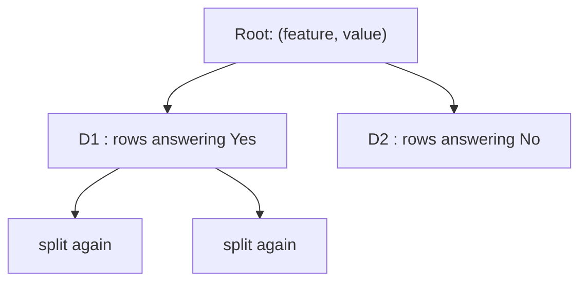
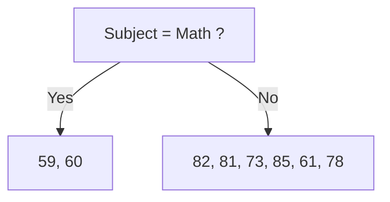
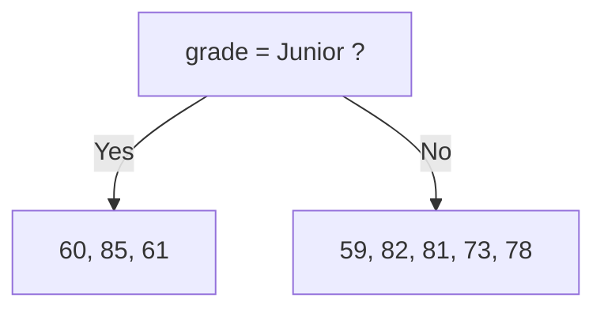
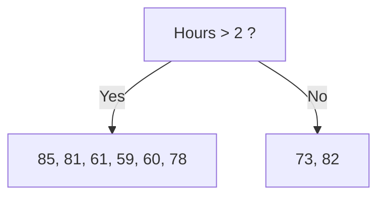
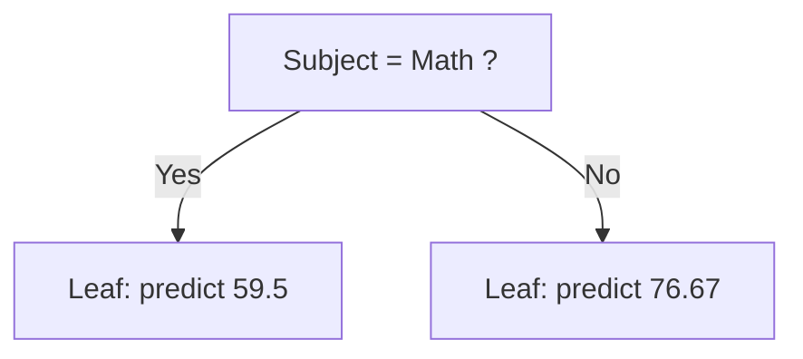
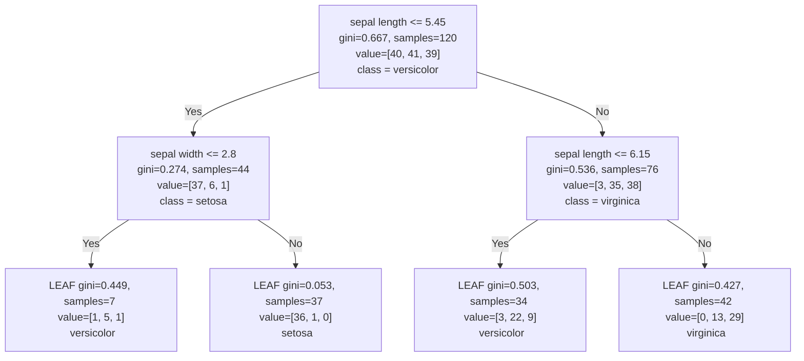
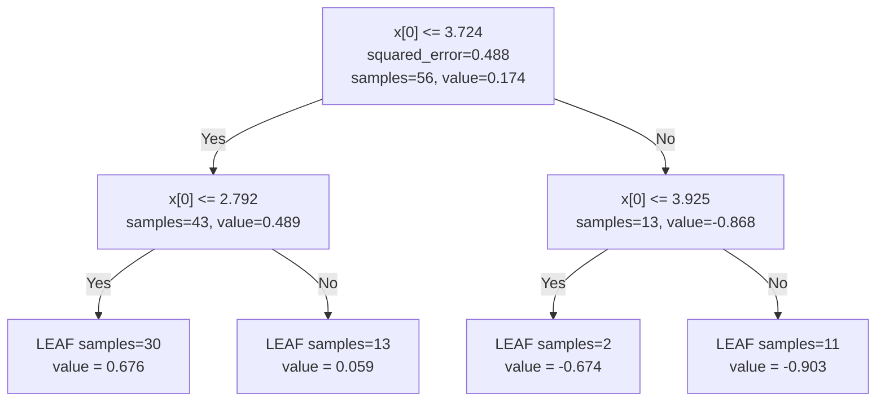
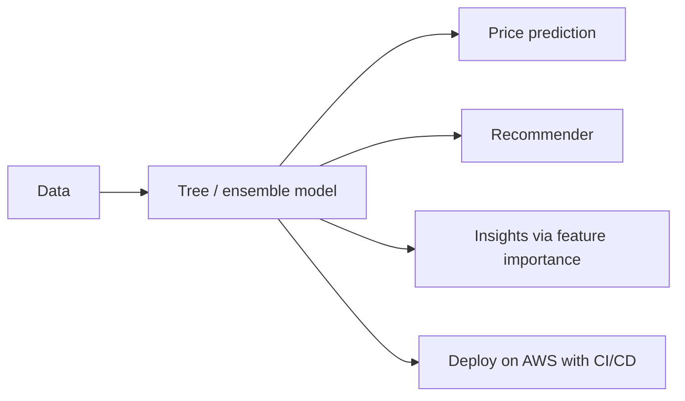

# Decision Trees, Part 2: Regression, Prediction & Feature Importance

> **Series:** [Part 1: Foundations & CART](../01-foundations-and-cart/README.md) · **Part 2: Regression, Prediction & Feature Importance** (this file) · [Part 3: Overfitting & Pruning](../03-overfitting-and-pruning/README.md)

Part 1 taught how a tree is *grown* for classification. This part covers:

- how the **same algorithm handles regression** (predicting numbers),
- what a regression tree **looks like geometrically**,
- exactly **how a trained tree makes a prediction** (classification, regression, and probabilities),
- how to find out **which features matter most** (feature importance),
- the full list of **advantages and disadvantages**.

**Prerequisite:** Part 1 (CART, Gini, splitting). 

---

## Table of Contents

1. [Recap](#1-recap)
2. [CART for Regression](#2-cart-for-regression)
3. [Geometric Intuition](#3-geometric-intuition)
4. [How Prediction is Done](#4-how-prediction-is-done)
5. [Code](#5-code)
6. [Advantages & Disadvantages](#6-advantages--disadvantages)
7. [Feature Importance](#7-feature-importance)
8. [Summary & Practice Questions](#8-summary--practice-questions)

---

## 1. Recap

| Idea from Part 1 | One-line reminder |
|---|---|
| Decision tree | A learned nested if-else; non-parametric; white-box; handles classification and regression |
| CART | Greedy, top-down, binary splits; for every node, try every (feature, threshold) pair |
| Split score | $G = \dfrac{n_{left}}{n}H_{left} + \dfrac{n_{right}}{n}H_{right}$, keep the **minimum** |
| Impurity $H()$ | **Gini / entropy** for classification, **MSE / variance** for regression |
| Categorical splits | One-vs-rest questions |
| Numerical splits | Midpoints of the sorted values |
| Geometry | Axis-parallel rectangles |
| Weakness | Overfitting (fixed in Part 3) |

---

## 2. CART for Regression

### 2.1 What changes, what doesn't

The CART skeleton is unchanged: *try every (feature, value) → split into $D_1$ and $D_2$ → compute the impurity of each → combine with weights → keep the lowest.* Only the **impurity function** and the **leaf prediction** are different.



| | Classification | Regression |
|---|---|---|
| Target | Category | Number |
| Impurity function $H()$ | **Gini** (or entropy) | **MSE / Variance** |
| What "pure" means | Only one class in the node | All target values in the node are (nearly) identical |
| Aim of a split | Make children purer | Make the target values in each child **closer together** (lower variance) |
| Best split | Minimum weighted Gini | **Minimum weighted variance**, i.e. **maximum variance reduction** |
| Leaf prediction | Majority class | **Mean** of the targets in the leaf |

> **Why not Gini for regression?** Gini needs discrete classes (it counts how often each class appears). A target like `Test_Score` has no classes, so we measure *spread* instead.

### 2.2 The impurity: variance (MSE)

For a node with target values $y_1, \dots, y_n$ and mean $\bar{y}$:

$$
H(\text{node}) = \text{Var} = \frac{1}{n}\sum_{i=1}^{n}(y_i - \bar{y})^2
$$

This equals the **MSE** you would get by predicting $\bar{y}$ for every row in the node. The mean is the value that minimizes squared error, which is why the **leaf predicts the mean**.

**Overall impurity of a candidate split:**

$$
V_{overall} = \frac{n_{left}}{n}\, V_{left} + \frac{n_{right}}{n}\, V_{right}
$$

### 2.3 The dataset

| | Subject | Grade_Level | Hours_Studied | Test_Score |
|--|---------|-------------|---------------|------------|
| 0 | Math | Freshman | 4 | 59 |
| 1 | Physics | Freshman | 1 | 82 |
| 2 | Physics | Freshman | 4 | 81 |
| 3 | Math | Junior | 6 | 60 |
| 4 | Physics | Sophomore | 1 | 73 |
| 5 | Physics | Junior | 3 | 85 |
| 6 | Physics | Junior | 4 | 61 |
| 7 | Physics | Freshman | 9 | 78 |

Feature types: `Subject` is **binary**, `Grade_Level` is **multi-class**, `Hours_Studied` is **numerical**. Target: `Test_Score`.

**Before any split** (the root, all 8 rows): mean $= 579/8 = 72.375$ and variance $\approx \mathbf{102.48}$. A useful split must bring $V_{overall}$ *below* this number.

### 2.4 Binary categorical feature: `Subject = Math ?`



**Yes-branch** `{59, 60}`: mean $= 59.5$

$$
V_{yes} = \frac{(59 - 59.5)^2 + (60 - 59.5)^2}{2} = \frac{0.25 + 0.25}{2} = 0.25
$$

**No-branch** `{82, 81, 73, 85, 61, 78}`: mean $= 460/6 \approx 76.67$

$$
V_{no} = \frac{(82-76.67)^2 + (81-76.67)^2 + (73-76.67)^2 + (85-76.67)^2 + (61-76.67)^2 + (78-76.67)^2}{6} \approx 62.89
$$

**Overall:**

$$
V_{overall} = \frac{2}{8}(0.25) + \frac{6}{8}(62.89) \approx \mathbf{47.23}
$$

Variance reduction: $102.48 - 47.23 = 55.25$. That's a big drop.

### 2.5 Multi-class categorical feature: `Grade_Level`

Three categories → three one-vs-rest candidates:

1. `{Freshman}` vs `{Junior, Sophomore}`
2. `{Junior}` vs `{Freshman, Sophomore}`
3. `{Sophomore}` vs `{Freshman, Junior}`



Worked example for `Grade = Junior`:

- Yes `{60, 85, 61}`: mean 68.67, variance $\approx 133.56$
- No `{59, 82, 81, 73, 78}`: mean 74.6, variance $\approx 70.64$
- $V_{overall} = \frac{3}{8}(133.56) + \frac{5}{8}(70.64) \approx \mathbf{94.23}$

The other two candidates are computed identically (results in the summary table below).

### 2.6 Numerical feature: `Hours_Studied`

**Step 1: Sort by hours.**

| Hours | 1 | 1 | 3 | 4 | 4 | 4 | 6 | 9 |
|---|---|---|---|---|---|---|---|---|
| Score | 82 | 73 | 85 | 59 | 81 | 61 | 60 | 78 |

**Step 2: Midpoints of consecutive distinct values** (1, 3, 4, 6, 9): **2, 3.5, 5, 7.5**

```
 sorted hours:   1  1     3     4  4  4     6        9
 thresholds:        ^2    ^3.5       ^5      ^7.5
```

**Step 3: Score each threshold.** Example `Hours > 2`:



- Yes: mean 70.67, variance $\approx 118.22$
- No: mean 77.5, variance $= 20.25$
- $V_{overall} = \frac{6}{8}(118.22) + \frac{2}{8}(20.25) \approx \mathbf{93.73}$

Same for `Hours > 3.5` (Yes `{81, 61, 59, 60, 78}`, No `{82, 73, 85}`):

- Yes mean 67.8, variance $\approx 92.56$; No mean 80, variance $= 26.0$
- $V_{overall} = \frac{5}{8}(92.56) + \frac{3}{8}(26.0) \approx \mathbf{67.60}$

### 2.7 All candidates and the winner

| Candidate split | $V_{left/yes}$ | $V_{right/no}$ | $V_{overall}$ |
|---|---|---|---|
| **Subject = Math** | 0.25 | 62.89 | **47.23** ← minimum |
| Grade = Freshman | 87.50 | 103.69 | 95.59 |
| Grade = Junior | 133.56 | 70.64 | 94.23 |
| Grade = Sophomore | 0.00 | 117.06 | 102.43 |
| Hours > 2 | 118.22 | 20.25 | 93.73 |
| Hours > 3.5 | 92.56 | 26.00 | 67.60 |
| Hours > 5 | 81.00 | 104.58 | 98.69 |
| Hours > 7.5 | 0.00 | 111.96 | 97.96 |

**Winner:** `Subject = Math` ($V_{overall} = 47.23$), so it becomes the **root question**. The tree then recurses on both children (the `{59, 60}` child is already tiny; the 6-row child gets split further).

**A depth-1 tree for this data:**



Prediction for `(Math, Freshman, 4 hours)` → **59.5**. For `(Physics, Junior, 4 hours)` → **76.67**.

### 2.8 Visualizing "variance versus threshold"

For a numerical feature, plot $V_{overall}$ against each candidate threshold. CART picks the **lowest point of the curve**:

```
 V_overall
  100 |                       #    #
   95 |    #                  
   90 |                       
   70 |            # 
   65 |            ^ lowest -> Hours > 3.5 is the best cut on this feature
      +------------------------------
           2     3.5     5     7.5     threshold on Hours
```

This is the "geometry" of the choice: the threshold that best separates the data into groups with similar scores.

### 2.9 Other impurity measures for regression: MAE and the median

| Criterion | Impurity | Leaf value | sklearn name | When to use |
|---|---|---|---|---|
| **MSE** (variance) | $\frac{1}{n}\sum (y_i - \bar y)^2$ | **Mean** | `"squared_error"` (default) | General purpose; sensitive to outliers |
| **MAE** | $\frac{1}{n}\sum \lvert y_i - \text{median} \rvert$ | **Median** | `"absolute_error"` | Robust to outliers; slower to train |
| Poisson | Poisson deviance | Mean | `"poisson"` | Count targets |

> **Intuition:** squared error punishes a big miss *a lot* (a miss of 10 costs 100), so the mean gets dragged toward outliers. Absolute error punishes a miss of 10 as 10, so the median stays put.

### 2.10 Regression-tree algorithm at a glance

```text
1. At a node, for each feature and each candidate threshold, compute V_overall.
2. Choose the split with minimum V_overall (maximum variance reduction).
3. Recurse on the two children.
4. Stop at max depth / min samples / zero variance.
5. Each leaf predicts the MEAN of its training targets.
```

---

## 3. Geometric Intuition

### 3.1 Regression with CART = chopping the x-axis

For one feature (say `hours`) and a target (`exam result`), every split is a **vertical cut on the x-axis**. Between two cuts the model predicts a **single constant**: the mean of the training targets that fall there.

```
 y (marks)
  |                   ____________
  |        ___________|           |________
  |  ______|                               |____
  | |                                           |_____
  +-------------------------------------------------- x (hours)
     region 1   region 2     region 3          region 4
```

This is called a **piecewise constant approximation**: the true relationship might be a smooth curve, but the tree approximates it with flat steps.

### 3.2 Tree versus linear regression on the same data

| | Linear regression | Decision tree regression |
|---|---|---|
| Model | One equation: $y = mx + b$ | A staircase of constants |
| Output for a new $x$ | Computed from the equation | The **mean of the leaf** the point lands in |
| Smooth? | Yes | **No** (jumps at thresholds) |
| Captures curves? | Only with extra features | Yes, by adding steps |
| Extrapolation | Continues the line | **Cannot** (flat beyond the data) |

### 3.3 Why a tree cannot extrapolate

Suppose the training data has $x \in [0, 5]$ and you ask for $x = 35$.

- A **linear model** plugs 35 into $y = mx + b$ and keeps following the trend.
- A **tree** sends 35 right at every "x > threshold" question, lands in the **last (rightmost) leaf**, and returns that leaf's mean. The prediction for $x = 35$ equals the prediction for $x = 5$.

```
 y |                        . . . . . . . . . .   <- tree: flat forever
   |                   ____/
   |              ____/        ........ linear trend would keep rising
   |         ____/
   +--------------------+------------------------- x
            training range ends (x = 5)       x = 35 ?
```

> **Takeaway:** trees are great *inside* the range they have seen, and unreliable outside it. Use them where new data will resemble the training data.

### 3.4 The role of depth

| Depth | Regions | Behaviour |
|---|---|---|
| 1 | 2 | One big step. Underfits. |
| 2-4 | 4-16 | Captures the main trend. |
| Very deep | ≈ one per training point | Follows noise (overfits, see Part 3). |

Each leaf's constant is the mean of the points inside its region, so more depth means smaller regions and a tighter fit to the training data.

### 3.5 Example: a noisy curve

On a noisy sine wave with `max_depth=2`, the prediction is **about 3-4 flat steps** that follow the shape: high on the left, falling in the middle, low on the right. With a very large depth, the line chases every noisy point.

---

## 4. How Prediction is Done

**Rule: start at the root, answer each question about your input, follow the Yes/No branch, repeat until you reach a leaf, then read the answer stored there.**

Prediction is cheap: one comparison per level. A tree of depth $d$ needs only $d$ comparisons.

### 4.1 Classification

Consider this trained Iris tree. Each box shows the question, its Gini, the number of training samples, `value = [setosa, versicolor, virginica]` counts, and the majority class.



**Trace 1: input `{SL = 4.9, SW = 3}`**

| Step | Question | Answer | Go |
|---|---|---|---|
| 1 | SL ≤ 5.45 ? | 4.9 ≤ 5.45 → **Yes** | left |
| 2 | SW ≤ 2.8 ? | 3 ≤ 2.8 → **No** | right |
| 3 | Leaf `[36, 1, 0]` | majority = setosa | **Setosa** |

**Trace 2: input `{SL = 6, SW = 2}`**

| Step | Question | Answer | Go |
|---|---|---|---|
| 1 | SL ≤ 5.45 ? | 6 ≤ 5.45 → **No** | right |
| 2 | SL ≤ 6.15 ? | 6 ≤ 6.15 → **Yes** | left |
| 3 | Leaf `[3, 22, 9]` | majority = versicolor | **Versicolor** |

Notice in Trace 2 that `SW = 2` is **never used**: a tree only asks the questions along *one* path.

> **Classification rule:** a leaf predicts the **majority class** (the class with the highest count) among the training samples that reached it.

### 4.2 Probability output

The same leaf counts give **class probabilities**: the fraction of each class in the leaf.

Leaf `[3, 22, 9]` has 34 training samples:

$$
P(\text{setosa}) = \tfrac{3}{34} \approx 0.09, \quad
P(\text{versicolor}) = \tfrac{22}{34} \approx 0.65, \quad
P(\text{virginica}) = \tfrac{9}{34} \approx 0.26
$$

The probabilities sum to 1, and the predicted class is the one with the largest probability. In sklearn: `clf.predict_proba(X)`.

| Leaf | Counts | Max probability | How confident? |
|---|---|---|---|
| E | `[36, 1, 0]` | 36/37 ≈ 0.97 | Very confident |
| F | `[3, 22, 9]` | 22/34 ≈ 0.65 | Moderate |
| D | `[1, 5, 1]` | 5/7 ≈ 0.71 | Moderate, but only 7 samples |

**Caveats:**
- **Every sample in a leaf receives the same probabilities**, so a single tree's probabilities are coarse (just a few distinct values).
- A leaf with very few samples gives unreliable probabilities (e.g. `[0, 1, 0]` gives 100% from one point). Ensembles average many trees and give smoother, better-calibrated probabilities.

### 4.3 Regression

For regression the leaf holds a **number**: the mean target of the training rows in that region.



This tree has `max_depth = 2` (counted from the node shown). Each leaf corresponds to one region of the x-axis: R1, R2, R3, R4, from left to right.

**Trace: input `x = 2.9`**

| Step | Question | Answer | Go |
|---|---|---|---|
| 1 | x ≤ 3.724 ? | **Yes** | left |
| 2 | x ≤ 2.792 ? | 2.9 ≤ 2.792 → **No** | right |
| 3 | Leaf | value = **0.059** | **y = 0.059** |

> **Regression rule:** a leaf predicts the **mean of the training targets** in its region. Every input that falls in the same region receives the **exact same output**: the "memory" of all the training points in that region.

### 4.4 Classification vs regression: aggregation at the leaf

| Task | What the leaf stores | Prediction |
|---|---|---|
| Classification | Class counts | **Majority count** (class with the largest count), and counts ÷ total = probabilities |
| Regression | Target values | **Mean** (or median for MAE) |

### 4.5 What each node displays

| Where | What it shows |
|---|---|
| **On a leaf node** | The final prediction: majority class (classification) or mean (regression), plus the counts / sample size, and its impurity. |
| **On a decision node** | The splitting **question**, the node's **impurity**, the **number of samples**, and a `value` (counts, or mean). That `value` is *what the node would predict if the tree stopped here*. It matters for shallow trees and for **pruning** (Part 3), where a decision node can be turned into a leaf. |
| **Probability output** | Class fractions from the leaf counts (`predict_proba`). |

### 4.6 The decision path: why trees are white-box

A prediction is fully explained by the **list of nodes visited**. That list is the model's reasoning: *"Sepal length was at most 5.45, but the sepal width was above 2.8, therefore Setosa."* This is why decision trees are called **white-box**.

---

## 5. Code

### 5.1 Classification: prediction, probabilities, rules

```python
from sklearn.datasets import load_iris
from sklearn.tree import DecisionTreeClassifier, export_text

iris = load_iris()
X, y = iris.data[:, :2], iris.target                 # sepal length, sepal width

clf = DecisionTreeClassifier(max_depth=2, random_state=0).fit(X, y)

# 1) class prediction
print(clf.predict([[4.9, 3.0]]))                     # array([0])  -> setosa

# 2) probability output (class fractions in the leaf)
print(clf.predict_proba([[6.0, 2.0]]))

# 3) which leaf did the sample land in?
print(clf.apply([[6.0, 2.0]]))                       # leaf node id

# 4) the path of nodes visited (sparse matrix of 0/1 per node)
print(clf.decision_path([[6.0, 2.0]]).toarray())

# 5) the whole tree as readable rules
print(export_text(clf, feature_names=["sepal length", "sepal width"]))
```

### 5.2 Regression: the 8-row dataset

```python
import pandas as pd
from sklearn.tree import DecisionTreeRegressor, export_text

d = pd.DataFrame({
    "Subject": ["Math","Physics","Physics","Math","Physics","Physics","Physics","Physics"],
    "Hours":   [4, 1, 4, 6, 1, 3, 4, 9],
    "Score":   [59, 82, 81, 60, 73, 85, 61, 78],
})
X = pd.get_dummies(d[["Subject", "Hours"]], columns=["Subject"])   # Subject_Math, Subject_Physics
y = d["Score"]

reg = DecisionTreeRegressor(max_depth=1, random_state=0).fit(X, y)
print(export_text(reg, feature_names=list(X.columns)))
# |--- Subject_Math <= 0.50  -> value: [76.67]
# |--- Subject_Math >  0.50  -> value: [59.50]
```

This confirms the hand calculation: the root question is `Subject = Math`.

### 5.3 Regression: the noisy curve and extrapolation test

```python
import numpy as np
from sklearn.tree import DecisionTreeRegressor

X = np.linspace(0, 5, 100)[:, None]
y = np.sin(X).ravel()

reg = DecisionTreeRegressor(max_depth=3).fit(X, y)
print(reg.predict([[5.0], [35.0]]))     # the two predictions are identical: no extrapolation
```

---

## 6. Advantages & Disadvantages

### 6.1 Advantages

| Advantage | Details |
|---|---|
| **Simple to understand and to interpret** | Trees can be visualized and read as rules. |
| **Requires little data preparation** | Other techniques often need **data normalization**, **dummy variables**, and **blank values removed**. Note that (in the sklearn version these notes follow) the module does not support missing values; newer releases do for some splitters. |
| **Cheap to use** | The cost of predicting is **logarithmic** in the number of training points. |
| **Handles numerical and categorical data** | See Part 1 for how each is split. |
| **Works on non-linear datasets** | Piecewise-constant regions can approximate curves. |
| **Can give you feature importance** | A built-in measure of which features drive the predictions (Section 7). |

### 6.2 Disadvantages

| Disadvantage | Details |
|---|---|
| **Overfitting** | Over-complex trees that do not generalize well. Fix: **pruning**, setting the **minimum number of samples at a leaf**, or setting the **maximum depth** (Part 3). |
| **Instability** | **Small variations in the data** might result in a **completely different tree**. Mitigated by using trees **within an ensemble**. |
| **No smooth or continuous predictions** | Predictions are **piecewise constant approximations**, so **trees are not good at extrapolation**. |

### 6.3 More on the extrapolation limitation

> This limitation is **inherent to the structure** of decision-tree models. They are very useful for **interpretability** and for handling **non-linear relationships within the range of the training data**, but they aren't designed for extrapolation. If extrapolation is important for your task, you might need to consider other models.

Examples where this bites: forecasting prices next year when prices trend upward; predicting house prices for a size larger than any house in the data; any time-series trend.

---

## 7. Feature Importance

### 7.1 Definition

> The importance of a feature is computed as the **(normalized) total reduction of the criterion** brought by that feature. It is also known as the **Gini importance** (and, more generally, **Mean Decrease in Impurity, MDI**).

Plain English: *every time the tree splits on a feature, the data becomes purer. Add up all those improvements for each feature, then express each feature's total as a share of the grand total.*

### 7.2 Formulas

**Step 1: the importance $n_i$ of a single node** (how much impurity its split removed, weighted by how many samples reach it):

$$
n_i = \frac{N_t}{N}\left[\; \text{impurity} \;-\; \frac{N_{t_R}}{N_t}\times \text{right\_impurity} \;-\; \frac{N_{t_L}}{N_t}\times \text{left\_impurity} \;\right]
$$

| Symbol | Meaning |
|---|---|
| $N$ | Total number of samples in the training set |
| $N_t$ | Samples reaching this node $t$ |
| $N_{t_L}, N_{t_R}$ | Samples going to the left / right child |
| impurity | Gini (or variance) of the node |
| left_impurity, right_impurity | Gini (or variance) of the children |

The bracket is "parent impurity minus weighted child impurity" (the impurity decrease). The factor $N_t / N$ scales it by how big the node is, so a split near the root counts more than a split affecting five samples.

**Step 2: the importance $fi_k$ of feature $k$:**

$$
fi_k = \frac{\displaystyle\sum_{j \,\in\, \text{nodes that split on feature } k} n_i^{(j)}}{\displaystyle\sum_{j \,\in\, \text{all nodes}} n_i^{(j)}}
$$

Numerator: add the node importances of **every node that used feature $k$**. Denominator: add the node importances of **all nodes** (leaves contribute 0 because they don't split). So the importances **sum to 1**.

### 7.3 Reading the formula

```
 Tree with 3 decision nodes:

        [ SL ]  root, importance x
        /    \
    [ SW ]   [ SL ]
   importance y   importance z

   fi(SL) = (x + z) / (x + y + z)       <- SL used twice
   fi(SW) =     y   / (x + y + z)
```

A feature scores high when it is used **near the top** (large $N_t$) and its splits **remove a lot of impurity**.

A fully worked numerical example on the Iris tree is in [Part 3, Section 2](../03-overfitting-and-pruning/README.md#2-feature-importance-worked-example).

### 7.4 Code

```python
import pandas as pd
imp = pd.Series(clf.feature_importances_, index=["sepal length", "sepal width"])
print(imp.sort_values(ascending=False))      # values sum to 1
```

### 7.5 Cautions (read before trusting the numbers)

| Issue | Explanation | Alternative |
|---|---|---|
| **Bias toward high-cardinality / continuous features** | Features with many possible thresholds get more chances to find a lucky split | **Permutation importance** (`sklearn.inspection.permutation_importance`) |
| **Computed on training data** | Reflects what the tree *used*, not necessarily what generalizes | Compute permutation importance on a **test set** |
| **Correlated features share credit unpredictably** | Two near-copies of a feature: one may take all the credit | Group or drop correlated features |
| **Importance is not causation** | It says what the model used, not what causes the outcome | Domain knowledge, controlled experiments |

### 7.6 Where feature importance is used: a project example

These are notes from a **real-estate (flats) project** where tree models power several features:

**Regression:**
- A **flat tentative price system**: predict a flat's approximate price from its attributes.

**Recommender system:**
- *Suggest more flats like this one.*
- *Society (housing complex) suggestions.*

**Analysis:**
- **City level** and **sector level** analysis.
- **Insight system (factors):** use the ML model for **inference**, asking *which factors affect price the most?* Feature importance answers this directly.

**Engineering / deployment:**
- **Deploy on AWS.**
- **CI/CD pipelines** for an efficient workflow (automated testing and deployment of model updates).



---

## 8. Summary & Practice Questions

### Summary

1. **Regression CART** = same algorithm, with **variance/MSE** as impurity and the **mean** as the leaf value.
2. The best split **minimizes weighted variance** $V_{overall} = \frac{n_L}{n}V_L + \frac{n_R}{n}V_R$.
3. Geometrically a regression tree is a **staircase** (piecewise constant). It **cannot extrapolate**.
4. **Prediction:** walk root → leaf. Classification: **majority class** (probabilities = class fractions). Regression: **mean**.
5. **Feature importance** = (normalized) total impurity reduction a feature brings. It sums to 1; handle with caution.

### Practice questions

1. A leaf has training targets `{10, 14, 18}`. What does a regression tree predict for a point landing there, and what is the node's variance? *(Answer: mean 14; variance $(16+0+16)/3 \approx 10.67$)*
2. A leaf has counts `[2, 6, 2]`. Give the predicted class and the probabilities. *(Answer: class 2 (the middle one); 0.2, 0.6, 0.2)*
3. Why is `Hours > 3.5` a better split than `Hours > 5` for the 8-row dataset?
4. Why can't a regression tree predict beyond the maximum value seen in training?
5. In the feature-importance formula, why is the node impurity decrease multiplied by $N_t / N$?
6. When would you prefer `criterion="absolute_error"` over `"squared_error"`?
7. A feature appears in no split of a trained tree. What is its importance? *(Answer: 0)*

**Previous:** [← Part 1: Foundations & CART](../01-foundations-and-cart/README.md) · **Next:** [Part 3: Overfitting & Pruning →](../03-overfitting-and-pruning/README.md)
