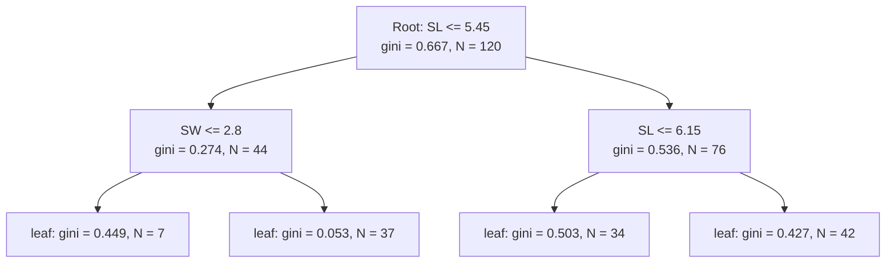
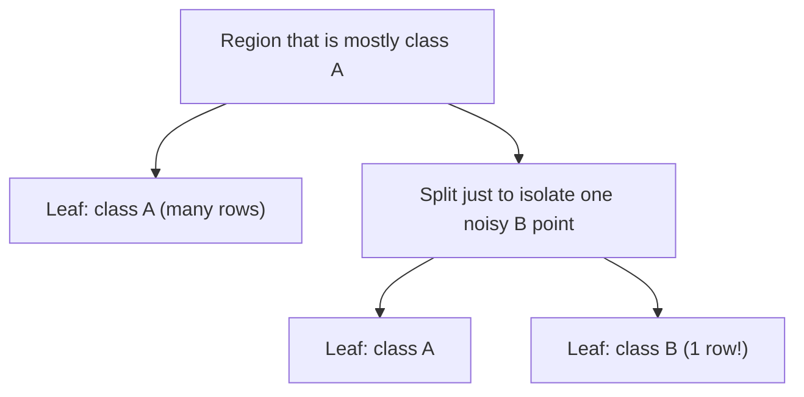
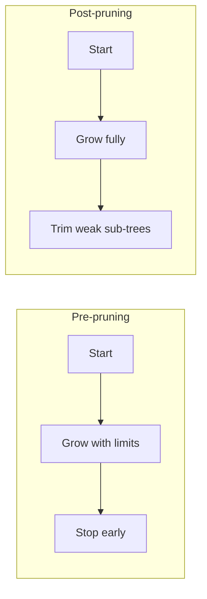
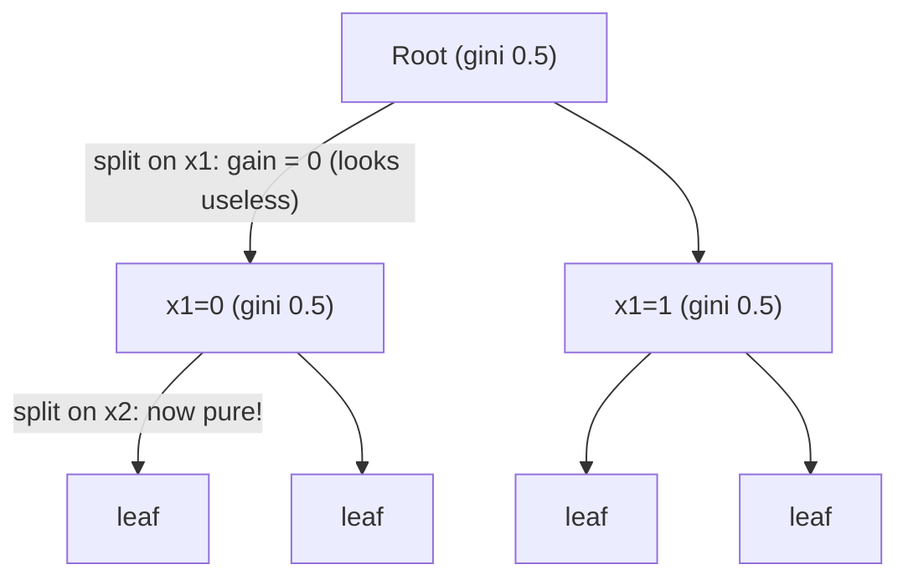
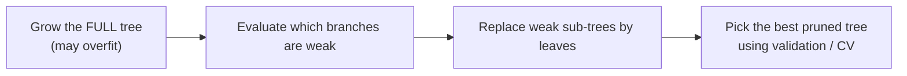
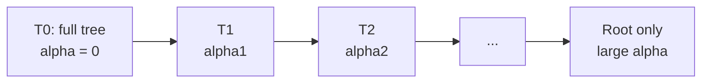

# Decision Trees, Part 3: Overfitting & Pruning

> **Series:** [Part 1: Foundations & CART](../01-foundations-and-cart/README.md) · [Part 2: Regression, Prediction & Feature Importance](../02-regression-prediction-and-feature-importance/README.md) · **Part 3: Overfitting & Pruning** (this file)

A decision tree left to grow freely will memorize its training data. This part explains **why that happens**, **how to see it**, and the two families of cures: **pre-pruning** (stop early) and **post-pruning** (grow, then trim), including a hand-worked **cost-complexity pruning** example and runnable code.

**Prerequisites:** Parts 1 and 2.

---

## Table of Contents

1. [Recap](#1-recap)
2. [Feature Importance: Worked Example](#2-feature-importance-worked-example)
3. [The Problem of Overfitting](#3-the-problem-of-overfitting)
4. [Why Overfitting Happens](#4-why-overfitting-happens)
5. [Pruning & its Types](#5-pruning--its-types)
6. [Pre-pruning](#6-pre-pruning)
7. [Post Pruning](#7-post-pruning)
8. [Cost Complexity Pruning](#8-cost-complexity-pruning)
9. [Pre vs Post Pruning: Choosing in Practice](#9-pre-vs-post-pruning-choosing-in-practice)
10. [Summary & Practice Questions](#10-summary--practice-questions)

---

## 1. Recap

| From | Key points |
|---|---|
| **Part 1** | A tree is a learned nested if-else. **CART** greedily picks the (feature, threshold) with minimum weighted impurity. Gini for classification. Splits are axis-parallel. |
| **Part 2** | Regression uses variance/MSE and predicts the **mean** in a leaf. Prediction = walk root → leaf (majority class or mean; probabilities = class fractions). **Feature importance** = normalized total impurity reduction. |
| **Open problem** | By default CART keeps splitting until leaves are pure, so the tree **overfits**. This part fixes it. |

---

## 2. Feature Importance: Worked Example

Part 2 gave the formulas. Here they are applied by hand to the depth-2 Iris tree ($N = 120$ training samples).



Recall:

$$
n_i = \frac{N_t}{N}\left[\text{impurity} - \frac{N_{t_R}}{N_t}\,\text{right\_impurity} - \frac{N_{t_L}}{N_t}\,\text{left\_impurity}\right]
$$

There are only **three decision nodes** (leaves contribute nothing). Name their importances:

- $x$: root node (splits on **SL**)
- $y$: left child (splits on **SW**)
- $z$: right child (splits on **SL**)

**Node 1, the root (feature SL):** $N_t = 120$, left child has 44 samples (gini 0.274), right child has 76 (gini 0.536).

$$
x = \frac{120}{120}\left[0.667 - \frac{76}{120}(0.536) - \frac{44}{120}(0.274)\right]
= 1 \times [0.667 - 0.340 - 0.100] \approx \mathbf{0.227}
$$

**Node 2, left child (feature SW):** $N_t = 44$, its children have 7 samples (gini 0.449) and 37 samples (gini 0.053).

$$
y = \frac{44}{120}\left[0.274 - \frac{37}{44}(0.053) - \frac{7}{44}(0.449)\right]
\approx 0.367 \times [0.274 - 0.045 - 0.071] \approx \mathbf{0.058}
$$

**Node 3, right child (feature SL):** $N_t = 76$, its children have 34 samples (gini 0.503) and 42 samples (gini 0.427).

$$
z = \frac{76}{120}\left[0.536 - \frac{42}{76}(0.427) - \frac{34}{76}(0.503)\right]
\approx 0.633 \times [0.536 - 0.236 - 0.225] \approx \mathbf{0.048}
$$

**Aggregate by feature:**

$$
fi_{SL} = \frac{x + z}{x + y + z} = \frac{0.227 + 0.048}{0.333} \approx \mathbf{0.83}
\qquad
fi_{SW} = \frac{y}{x + y + z} = \frac{0.058}{0.333} \approx \mathbf{0.17}
$$

| Feature | Nodes using it | Importance |
|---|---|---|
| Sepal length (SL) | root + right child | **≈ 0.83** |
| Sepal width (SW) | left child | **≈ 0.17** |
| Total | | 1.00 |

**Reading it:** in this tree, sepal length does about 83% of the work. It is used twice, and one of those uses is at the root where $N_t/N = 1$.

> This is the importance **for this particular small tree**. A deeper tree would have more nodes and different shares.

---

## 3. The Problem of Overfitting

### 3.1 Definition

> **Overfitting** happens when a model learns the training data **too well**, including its **noise and outliers**, which results in **poor performance on unseen (test) data**.

A decision tree is **especially susceptible** because it can keep adding splits until it classifies every training row perfectly. The result is a very complex tree that fits the quirks of the training sample and fails to **generalize**.

### 3.2 What overfitting looks like: classification

On a two-feature classification problem:

- The decision regions turn into **tiny jagged islands, thin slivers and narrow corridors** carved around individual training points.
- Many of those islands exist only to capture **one or two noisy or mislabeled points**.
- **Training accuracy ≈ 100%**, but **test points** that fall near those slivers get misclassified.

```
 Good fit:                       Overfit:
 +-----------------+            +--+--------------+--+
 |        |        |            |  |  # |   ____   |  |
 |   A    |   B    |            |A |  B |  | A  |  | B|
 |        |        |            |  |____|  |____|  |  |
 +-----------------+            +--+--------------+--+
  few big regions                many tiny regions around noisy points
```

### 3.3 What overfitting looks like: regression

- The prediction line is a **staircase with almost one step per training point**.
- It produces **sharp spikes** at outliers instead of following the smooth underlying trend.

```
 smooth truth :     ___---~~~---___
 overfit tree :    _|‾|_/‾|_|‾‾|_|‾|_       <- spikes at every noisy point
```

### 3.4 Bias, variance and the three regimes

| | **Underfit** | **Good fit** | **Overfit** |
|---|---|---|---|
| Tree size | Too small (e.g. depth 1) | Moderate | Very deep |
| Training error | High | Low | ≈ 0 |
| Test error | High | **Low** | **High** |
| Problem | **High bias** (too simple) | Balanced | **High variance** (too sensitive to the sample) |

### 3.5 See it yourself: training vs test accuracy as depth grows

Real run on the scikit-learn **Breast Cancer** dataset (75/25 stratified split, `random_state=42`):

| `max_depth` | Leaves | Train accuracy | Test accuracy |
|---|---|---|---|
| 1 | 2 | 0.923 | 0.923 |
| 2 | 4 | 0.958 | 0.909 |
| 3 | 7 | 0.977 | 0.944 |
| 4 | 11 | 0.988 | **0.951** |
| 5 | 15 | 0.995 | **0.951** |
| unlimited (depth 7) | 18 | **1.000** | 0.937 |

**Pattern:** training accuracy rises all the way to a perfect 1.000, but **test accuracy peaks around depth 4-5 and then drops**. The growing gap between the two columns is the signature of overfitting.

```python
import matplotlib.pyplot as plt
from sklearn.datasets import load_breast_cancer
from sklearn.model_selection import train_test_split
from sklearn.tree import DecisionTreeClassifier

X, y = load_breast_cancer(return_X_y=True)
X_tr, X_te, y_tr, y_te = train_test_split(X, y, test_size=0.25, random_state=42, stratify=y)

depths = range(1, 11)
train_acc, test_acc = [], []
for d in depths:
    t = DecisionTreeClassifier(max_depth=d, random_state=0).fit(X_tr, y_tr)
    train_acc.append(t.score(X_tr, y_tr))
    test_acc.append(t.score(X_te, y_te))

plt.plot(depths, train_acc, label="train")
plt.plot(depths, test_acc, label="test")
plt.xlabel("max_depth"); plt.ylabel("accuracy"); plt.legend(); plt.show()
```

### 3.6 How to detect overfitting

- **Large gap** between training and test (or cross-validation) score.
- **Perfect training score** (1.0 accuracy, or $R^2 = 1$) with a much lower test score.
- Very deep tree, or many leaves with only 1-3 samples.
- Predictions change a lot when the training data is slightly resampled (high variance).

**The cure is pruning**, covered from Section 5 onwards.

---

## 4. Why Overfitting Happens

### 4.1 Default CART grows until pure

Unless told otherwise, CART keeps splitting each node until it is **pure** (Gini 0 / zero variance) or cannot be split further. If the data has any noise, the only way to make every leaf pure is to build tiny, highly specific leaves.

**Upper bound:** a tree can have as many as **one leaf per training row** (depth up to $n - 1$), which means pure memorization.

```
 n training rows  ->  up to n leaves  ->  training accuracy 100%, nothing learned
```

### 4.2 Unnecessary nodes

Nodes that don't help generalization but exist anyway:

| Kind of unnecessary node | Why it appears |
|---|---|
| Splits that isolate **1-2 noisy or mislabeled points** | Making the child pure improves training impurity |
| Splits with **tiny impurity decrease** | Any positive improvement is accepted by default |
| **Leaves with very few samples** (even 1) | Nothing stops a split that leaves a single row on one side |
| Deep branches that only fit a **local quirk** | Greedy search keeps refining small groups |

A single noisy row is enough to force several extra levels:



### 4.3 Stopping criteria

To avoid this, we need **stopping criteria**: rules that decide *when to stop growing a branch*. Typical ones:

- a **maximum depth**,
- a **minimum number of samples** to attempt a split,
- a **minimum number of samples per leaf**,
- a **minimum impurity improvement** per split,
- a **maximum number of leaves**.

These are exactly the **pre-pruning** methods (Section 6). The alternative is to let the tree grow completely and then remove the weak parts, i.e. **post-pruning** (Sections 7-8).

---

## 5. Pruning & its Types

> **Pruning** is a technique used in machine learning to **reduce the size of decision trees** and to **avoid overfitting**.

- **Overfitting** happens when a model learns the training data too well, including its noise and outliers, resulting in poor performance on unseen or test data.
- Decision trees are susceptible because they can create very complex trees that classify the training data perfectly but fail to generalize.
- Pruning helps by **reducing the complexity** of the tree, thereby **improving its predictive power on unseen data**.

The gardening analogy is exact: a gardener cuts branches that add size but no fruit, so the plant puts its energy into the useful ones.

### Two main types

| | **1. Pre-pruning** (Early stopping) | **2. Post-pruning** (Cost Complexity Pruning and others) |
|---|---|---|
| **When** | **During** tree construction | **After** the tree has been grown to full size |
| **How** | Halt growth early: limit depth, minimum instances in a node to allow a split, or stop when a split improves the model less than a threshold | Remove nodes based on the **error-complexity trade-off**; replace a whole sub-tree by a leaf, giving the leaf the **most common class** of that sub-tree |
| **Philosophy** | "Don't let it get complicated" | "Let it get complicated, then simplify" |
| **Examples** | `max_depth`, `min_samples_split`, `min_samples_leaf`, `max_leaf_nodes`, `min_impurity_decrease`, `max_features` | **Cost Complexity Pruning (CCP)**, **Reduced Error Pruning** |



---

## 6. Pre-pruning

**Pre-pruning**, also called **early stopping**, prunes the tree **during the learning process**, as soon as it is clear that further splits will not add significant value.

### 6.1 The six strategies

#### 1. Maximum Depth (`max_depth`)

The simplest form. Set a limit on how deep the tree can grow. Once the specified depth is reached, **no new nodes are created**.

- ✅ Very simple to implement; effective against overfitting.
- ⚠️ If set **too low**, the tree becomes overly simple and **underfits**.
- Typical values to search: 3 to 10.

#### 2. Minimum Samples Split (`min_samples_split`)

A node is **split only if it has at least this many samples**. If the number of samples is below the threshold, the node is not split and becomes a **leaf**.

- Prevents the model from learning **noise** in tiny groups.
- Larger value → simpler tree.
- Example: `min_samples_split=20` means no node with fewer than 20 rows is ever split.

#### 3. Minimum Samples Leaf (`min_samples_leaf`)

A split is allowed only if it leaves **at least this many training examples in each child leaf**.

- Same noise-protection goal as above, but acts on the **outcome** of the split.
- Guarantees every prediction rests on enough data.
- Smooths regression predictions (each leaf averages more points).

> **Split vs leaf:** `min_samples_split` looks at the node **before** splitting; `min_samples_leaf` looks at the children **after** splitting. `min_samples_leaf=5` rejects a split that would create a leaf of 3 rows even when the parent had 100 rows.

#### 4. Maximum Leaf Nodes (`max_leaf_nodes`)

Limits the **total number of leaf nodes**. The tree **stops growing when the number of leaves reaches the maximum**. (In sklearn, setting this makes the tree grow *best-first*, always expanding the most beneficial node next, so the limited leaves are spent where they matter most.)

#### 5. Minimum Impurity Decrease (`min_impurity_decrease`)

A node is split **only if the impurity decrease of the split is above a threshold**. Impurity measures how mixed the classes in a node are; if the decrease is too small, the node becomes a leaf.

sklearn's decrease is exactly the node-importance formula from Part 2:

$$
\frac{N_t}{N}\left[\text{impurity} - \frac{N_{t_R}}{N_t}\,\text{right\_impurity} - \frac{N_{t_L}}{N_t}\,\text{left\_impurity}\right] \;\ge\; \texttt{min\_impurity\_decrease}
$$

#### 6. Maximum Features (`max_features`)

At each split, **only a random subset of features is considered** (e.g. `"sqrt"`, `"log2"`, or a number). The number of features to consider can be defined.

- Reduces overfitting and speeds training.
- This is the core trick behind **Random Forests** (many such randomized trees averaged).

### 6.2 Summary table

| # | Strategy | sklearn parameter | Controls | Too aggressive → |
|---|---|---|---|---|
| 1 | Maximum depth | `max_depth` | How many levels | Underfit |
| 2 | Min samples to split | `min_samples_split` | Smallest node allowed to split | Underfit |
| 3 | Min samples per leaf | `min_samples_leaf` | Smallest leaf allowed | Underfit |
| 4 | Max leaf nodes | `max_leaf_nodes` | Total leaves | Underfit |
| 5 | Min impurity decrease | `min_impurity_decrease` | Smallest worthwhile improvement | Underfit |
| 6 | Max features | `max_features` | Features tried per split | Weaker individual splits |

### 6.3 Code

```python
from sklearn.tree import DecisionTreeClassifier
from sklearn.model_selection import GridSearchCV

pre_pruned = DecisionTreeClassifier(
    max_depth=4,
    min_samples_split=10,
    min_samples_leaf=5,
    max_leaf_nodes=20,
    min_impurity_decrease=0.001,
    max_features="sqrt",
    random_state=42,
).fit(X_tr, y_tr)

print("train:", pre_pruned.score(X_tr, y_tr), " test:", pre_pruned.score(X_te, y_te))

# Better: let cross-validation pick the values
grid = GridSearchCV(
    DecisionTreeClassifier(random_state=42),
    param_grid={
        "max_depth": [3, 4, 5, 6, None],
        "min_samples_leaf": [1, 3, 5, 10],
        "min_samples_split": [2, 10, 20],
    },
    cv=5,
).fit(X_tr, y_tr)
print(grid.best_params_, grid.best_score_)
```

### 6.4 Advantages of Pre-Pruning

1. **Simplicity.** Criteria such as maximum depth or minimum samples per leaf are easy to understand and implement.
2. **Computational efficiency.** By limiting the size of the tree, pre-pruning substantially reduces the cost of **training and prediction**.
3. **Reduced overfitting.** It prevents the tree from becoming overly complex, improving generalization.
4. **Improved interpretability.** Simpler trees with fewer nodes are easier for humans to read.

### 6.5 Disadvantages of Pre-Pruning

1. **Risk of underfitting.** If the stopping criteria are too strict, growth halts too early and the model may miss important patterns.
2. **Requires fine-tuning.** Parameters like maximum depth or minimum samples per leaf need careful tuning to balance underfitting and overfitting (use cross-validation).
3. **Short-sightedness.** It **can prune good nodes that come after a bad node.** A split that looks useless *now* may be what enables a very useful split *below* it.

#### Short-sightedness illustrated: the XOR problem

Four points, class = XOR of two binary features:

| $x_1$ | $x_2$ | class |
|---|---|---|
| 0 | 0 | 0 |
| 0 | 1 | 1 |
| 1 | 0 | 1 |
| 1 | 1 | 0 |

- The root has Gini 0.5. Splitting on $x_1$ (or $x_2$) gives two children that are **each still 50/50 (Gini 0.5)**, so the **impurity decrease is exactly 0**.
- With a rule like `min_impurity_decrease > 0`, the tree **refuses to split at all** and ends as a single leaf. Verified: with `min_impurity_decrease=0.01`, sklearn returns **1 leaf**.
- Yet one more level of splits would classify everything **perfectly** (the default unlimited tree has depth 2).



A pre-pruner stops at the "useless" first split and never discovers the great second one. **Post-pruning does not have this problem**, because the full tree is built first.

---

## 7. Post Pruning

**Post-pruning**, also called **backward pruning**, prunes the tree **after it has been built** to its full size. The tree is allowed to grow, and then branches that don't pay for their complexity are cut off.



### 7.1 The two strategies

#### 1. Cost Complexity Pruning (CCP)

Also known as **Weakest Link Pruning**. It introduces a tuning parameter **$\alpha$** that **trades off tree complexity against fit to the training data**. For each value of $\alpha$ there is an **optimal subtree** that minimizes the cost-complexity criterion. The subtree that minimizes the criterion over all values of $\alpha$ (judged on validation/cross-validation data) is chosen as the pruned tree. See Section 8 for the full treatment.

#### 2. Reduced Error Pruning (REP)

Starting at the **leaves**, each node is **replaced with its most popular class**. If the **accuracy on a validation set is not affected**, the change is **kept**.

```text
Reduced Error Pruning
1. Grow the full tree on the TRAINING set.
2. Hold out a VALIDATION set.
3. For each decision node (working bottom-up, leaves first):
     a. Temporarily replace the node's sub-tree with a leaf
        predicting the node's majority class.
     b. Measure validation accuracy.
     c. If accuracy did NOT get worse -> keep the replacement.
        Otherwise -> undo it.
4. Stop when no replacement can be made without hurting validation accuracy.
```

| | CCP | Reduced Error Pruning |
|---|---|---|
| Idea | Penalize size with $\alpha$, pick the best $\alpha$ | Keep a prune only if validation accuracy doesn't drop |
| Needs a separate validation set? | Can use cross-validation | **Yes** |
| In scikit-learn? | **Yes** (`ccp_alpha`) | No (implement manually) |
| Guided by | Training-impurity + size penalty | Held-out accuracy |

### 7.2 Advantages of Post-Pruning

1. **Reduced overfitting.** Post-pruning avoids overfitting the training data, giving better generalization and **better performance on unseen data**.
2. **Preserving complexity.** Unlike pre-pruning, the tree first grows to **full complexity**, so it can capture complex patterns *before* any pruning is done (this solves the XOR problem above).
3. **Better performance.** Post-pruned trees often **outperform pre-pruned trees** because they balance the **bias-variance trade-off** better.

### 7.3 Disadvantages of Post-Pruning

1. **Increased computational cost.** The **full tree must be grown first** before it can be pruned.
2. **Requires a validation set.** Many post-pruning methods need one to judge the effect of pruning, which **reduces the data available for training**.
3. **Complexity of implementation.** Methods with tuning parameters (like cost complexity pruning) are more complex to implement and understand than pre-pruning.
4. **Risk of underfitting.** As with pre-pruning, if **too much pruning** is done, the model becomes overly simple and fails to capture important patterns.

---

## 8. Cost Complexity Pruning

The section heading in the original notes was empty; this is the full explanation.

### 8.1 The core idea

A big tree fits the training data better but is more complex. CCP puts both on one scale:

$$
R_\alpha(T) \;=\; R(T) \;+\; \alpha \cdot \lvert T \rvert
$$

| Symbol | Meaning |
|---|---|
| $T$ | A tree (or sub-tree) |
| $R(T)$ | Total **error/impurity of its leaves** on the training data (the "fit" term; smaller is better) |
| $\lvert T \rvert$ | Number of **leaf nodes** (the "complexity" term) |
| $\alpha \ge 0$ | The **price per leaf** (the tuning parameter) |

**Effect of $\alpha$:**

| $\alpha$ | Result |
|---|---|
| $0$ | No penalty: the **full tree** has the lowest $R_\alpha$ |
| Small | Only the least useful branches are removed |
| Large | Heavy pruning; as $\alpha \to \infty$ the tree shrinks to the **root alone** |

### 8.2 The weakest link

For an internal node $t$ with sub-tree $T_t$, compare:

- **keeping** the sub-tree: error $R(T_t)$, with $\lvert T_t \rvert$ leaves;
- **collapsing** it into a single leaf: error $R(t)$, with 1 leaf.

Collapsing saves $\lvert T_t \rvert - 1$ leaves but costs $R(t) - R(T_t)$ extra error. The **effective alpha** is the price at which the two options tie:

$$
\alpha_{eff}(t) \;=\; \frac{R(t) - R(T_t)}{\lvert T_t \rvert - 1}
$$

> **"Extra error per leaf removed."** A node with a **small** $\alpha_{eff}$ barely helps (cheap to remove): it is the **weakest link** and is pruned first.

### 8.3 Hand-worked example

Suppose a tree trained on $N = 100$ rows contains two internal nodes **A** and **B**, each with two leaves. Errors are misclassification counts divided by $N$.

**Node A** (30 rows: 20 of class X, 10 of class Y), with leaves `[18, 2]` and `[2, 8]`:

- Collapse A into a single leaf predicting X: errors $= 10$ → $R(A) = 10/100 = 0.10$
- Keep the sub-tree: errors $= 2 + 2 = 4$ → $R(T_A) = 4/100 = 0.04$
- $\alpha_{eff}(A) = \dfrac{0.10 - 0.04}{2 - 1} = \mathbf{0.06}$

**Node B** (20 rows: 15 of class X, 5 of class Y), with leaves `[14, 1]` and `[1, 4]`:

- Collapse: errors $= 5$ → $R(B) = 0.05$
- Keep: errors $= 1 + 1 = 2$ → $R(T_B) = 0.02$
- $\alpha_{eff}(B) = \dfrac{0.05 - 0.02}{2 - 1} = \mathbf{0.03}$

**Weakest link first:** B has the smaller $\alpha_{eff}$ (0.03 < 0.06), so **B is pruned first**, then A.

| $\alpha$ range | What happens |
|---|---|
| $\alpha < 0.03$ | Full tree is best (both A and B survive) |
| $0.03 \le \alpha < 0.06$ | **B collapsed** into a leaf; A kept |
| $\alpha \ge 0.06$ | **A collapsed** too (and so on up the tree) |

### 8.4 The full algorithm

```text
Cost Complexity Pruning (weakest-link)
1. Grow the full tree T0.
2. For every internal node t, compute alpha_eff(t).
3. Find the node with the SMALLEST alpha_eff (the weakest link).
   Collapse it into a leaf. This gives a smaller tree T1 and records its alpha.
4. Repeat on T1, T2, ... until only the root remains.
   Result: a nested SEQUENCE of trees  T0 ⊃ T1 ⊃ T2 ⊃ ... ⊃ root
   with increasing alpha values.
5. Choose the best tree in the sequence using cross-validation
   (or a validation set).
```



Because $\alpha$ is a **single number to tune**, choosing the tree size reduces to a 1-D search.

### 8.5 Code with scikit-learn

```python
import numpy as np
from sklearn.tree import DecisionTreeClassifier
from sklearn.model_selection import GridSearchCV

# 1) Grow a full tree and get the sequence of effective alphas
full = DecisionTreeClassifier(random_state=0)
path = full.cost_complexity_pruning_path(X_tr, y_tr)
alphas = path.ccp_alphas[:-1]          # drop the last one (root-only tree)
print("number of candidate alphas:", len(alphas))

# 2) Pick the best alpha by 5-fold cross-validation
search = GridSearchCV(
    DecisionTreeClassifier(random_state=0),
    param_grid={"ccp_alpha": alphas},
    cv=5,
).fit(X_tr, y_tr)

best = search.best_estimator_
print("best alpha  :", search.best_params_["ccp_alpha"])
print("leaves      :", best.get_n_leaves(), " (full tree had", full.fit(X_tr, y_tr).get_n_leaves(), ")")
print("test score  :", best.score(X_te, y_te))
```

**Example result** (Breast Cancer, 75/25 stratified split, `random_state=42`):

| Model | Leaves | Train acc. | Test acc. |
|---|---|---|---|
| Full, unpruned tree | 18 | 1.000 | 0.937 |
| CCP, CV-chosen $\alpha \approx 0.0063$ | **6** | 0.974 | **0.944** |

The pruned tree has **a third of the leaves** (6 instead of 18), gives up some training accuracy (1.000 → 0.974), and **generalizes slightly better** (0.937 → 0.944): exactly the point of pruning. (Exact numbers vary with the data split.)

### 8.6 Visualizing the trade-off

Plot train and test accuracy against $\alpha$:

```python
import matplotlib.pyplot as plt

models = [DecisionTreeClassifier(random_state=0, ccp_alpha=a).fit(X_tr, y_tr) for a in alphas]
plt.plot(alphas, [m.score(X_tr, y_tr) for m in models], marker="o", drawstyle="steps-post", label="train")
plt.plot(alphas, [m.score(X_te, y_te) for m in models], marker="o", drawstyle="steps-post", label="test")
plt.xlabel("ccp_alpha"); plt.ylabel("accuracy"); plt.legend(); plt.show()
```

As $\alpha$ increases, **training accuracy falls** (simpler tree) while **test accuracy first rises** (noise removed) and then falls (over-pruned, underfit).

---

## 9. Pre vs Post Pruning: Choosing in Practice

### 9.1 Side-by-side

| Criterion | Pre-pruning | Post-pruning (CCP) |
|---|---|---|
| Decision time | While growing | After growing |
| Training cost | **Lower** (small tree only) | Higher (full tree first) |
| Risk of missing good deep splits | **Yes** (short-sighted, e.g. XOR) | No |
| Risk of underfitting | If limits are strict | If $\alpha$ is too large |
| Needs validation data | For tuning the limits | For choosing $\alpha$ |
| Ease | **Easy** | More involved |
| Typical quality | Good | Often slightly better |

### 9.2 A practical recipe

1. Start with a **fully grown tree** as a baseline and note the train-test gap.
2. Apply **cheap pre-pruning**: tune `max_depth` and `min_samples_leaf` with cross-validation.
3. For extra performance, **sweep `ccp_alpha`** with the cost-complexity path.
4. Compare using **cross-validated** score, not training score.
5. If a single tree is still unstable or not accurate enough, move to **ensembles** (Random Forest, Gradient Boosting): they fix the variance problem differently, by averaging many trees.

### 9.3 Common mistakes

| Mistake | Why it's wrong |
|---|---|
| Choosing hyperparameters by **training accuracy** | It always prefers the biggest tree |
| Tuning on the **test set** | Leaks information; use CV on training data |
| Setting `max_depth` very small "to be safe" | Causes underfitting |
| Forgetting **class imbalance** | A pruned tree may ignore the minority class; consider `class_weight` |

---

## 10. Summary & Practice Questions

### Summary

1. **Overfitting** = fitting noise. Trees overfit because CART grows until leaves are pure, creating **unnecessary nodes**.
2. **Signature:** training accuracy ≈ 100%, test accuracy noticeably lower.
3. **Pruning** reduces tree size to improve generalization.
4. **Pre-pruning** (stop early): `max_depth`, `min_samples_split`, `min_samples_leaf`, `max_leaf_nodes`, `min_impurity_decrease`, `max_features`. Simple and fast, but **short-sighted** and can underfit.
5. **Post-pruning** (grow, then trim): **Cost Complexity Pruning** minimizing $R(T) + \alpha\lvert T\rvert$ and **Reduced Error Pruning**. Better quality, more expensive, needs validation data.
6. **Weakest link:** the node with the smallest $\alpha_{eff} = \dfrac{R(t) - R(T_t)}{\lvert T_t \rvert - 1}$ is pruned first.

### Practice questions

1. A model has 100% training accuracy and 82% test accuracy. What is the likely problem, and name two ways to address it in a decision tree.
2. Explain the difference between `min_samples_split` and `min_samples_leaf`.
3. A node has 40 rows (30 X, 10 Y). Its sub-tree has two leaves, `[28, 2]` and `[2, 8]`, in a dataset of $N = 200$ rows. Compute $\alpha_{eff}$. *(Answer: $R(t) = 10/200 = 0.05$; $R(T_t) = 4/200 = 0.02$; $\alpha_{eff} = 0.03 / 1 = 0.03$)*
4. What happens to the tree as $\alpha \to 0$? As $\alpha \to \infty$?
5. Why can pre-pruning miss the XOR pattern while post-pruning finds it?
6. Why does Reduced Error Pruning need a validation set?
7. What does `max_features` have to do with Random Forests?
8. You found that depth 5 gives the best cross-validated score. Why should you still evaluate on a separate test set at the end?

**Previous:** [← Part 2: Regression, Prediction & Feature Importance](../02-regression-prediction-and-feature-importance/README.md)

*End of the Decision Trees series.*
